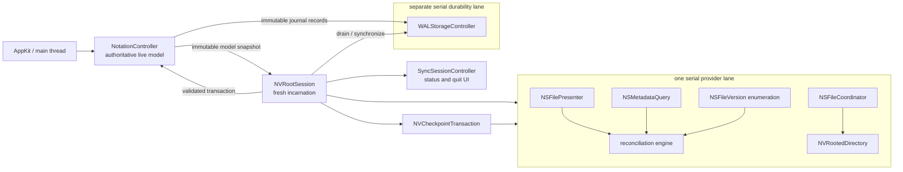

# iCloud Drive implementation architecture proposal 2

Status: proposed architecture; no implementation has begun.

This proposal implements the behavior in `docs/iCloud-Drive-Support-Spec.md` without introducing a second note store, a cloud database, a persistent sync ledger, or a new asynchronous search path. The live `NoteObject` graph remains authoritative while the app is running. Plain-text note files remain the routine cross-Mac representation. `Notes & Settings` remains a checkpoint and recovery artifact.

## Sources and terminology

This design uses the terminology in `CONTEXT.md` and was checked against these complete Markdown inputs:

- `docs/iCloud-Drive-Support-Spec.md`
- `docs/adr/0001-first-class-icloud-drive-support.md` through `docs/adr/0011-use-a-controlled-restart-for-encryption-changes.md`
- `docs/tla/README.md`
- `docs/Atomic-Note-Saves.md`
- `docs/Filesystem-Note-Lifecycle-TODO.md`

It was also cross-checked against the actions, invariants, and configurations in every model under `docs/tla/`, particularly `ReconciliationInterface.tla`. The specification and models remain normative when this proposal is less specific.

## Executive decision

Add one process-lifetime object, `NVRootSession`, between `NotationController` and every operation that can consult or change the selected notes root. It owns one serial provider lane and one fresh, non-reusable root-session incarnation. Move the existing directory reconciliation algorithm to that lane, but pass only immutable snapshots across the main-thread boundary. Keep WAL durability on a separate serial lane. Use a small, reusable `NVCheckpointTransaction` for every exact checkpoint installation.

Most of the hard data-path code already exists and should be reused:

- `NVRootedDirectory` supplies descriptor-relative, path-independent reads, catalogs, compare-and-swap writes, atomic replacement, exact readback, and directory synchronization.
- `NoteObject` supplies note serialization, filename policy, expected-byte writes, and conflict-preserving behavior.
- `NVMergedText` supplies the existing three-way plain-text merge.
- `DeletedNoteObject` supplies the checkpoint-archived, UUID/LSN-bound tombstone representation; its retention policy changes, not its identity model.
- `WALStorageController` supplies the record codec, coalescing, checksums, encryption framing where applicable, recovery parsing, and valid-prefix behavior.
- `FrozenNotation` supplies the checkpoint payload.
- `SyncSessionController` supplies the existing status surface and quit barrier.
- `NotationDirectoryManager.m` already contains the two-catalog fence, stable-file-identity matching, filename/content fallback, and detached transaction staging.
- `pendingFileWrites`, `pendingJournalWrites`, and their existing timers already supply latest-generation write admission/coalescing.
- `NotationPrefsViewController`, `PassphraseChanger`, and `databaseSettingsChangedFromOldFormat:` already supply the disclosure, external-editor shutdown, key UI, and all-note export admission needed by a controlled transition.

The implementation should not add a generic sync framework. The only new public classes are:

1. `NVRootSession`: lifecycle, provider ownership, reconciliation admission, and close orchestration.
2. `NVCheckpointTransaction`: one exact checkpoint installation and its optional provider qualification.

Presenter, query, lock, catalog/version snapshot, and decision objects stay private in the relevant `.m` files. There is only one provider product and one checkpoint product, so protocols, factories, and registries of strategies would be noise.

## Ownership and execution model



### Main thread

The main thread alone owns and mutates live `NoteObject`, `DeletedNoteObject`, preference, selection, search, and table state. Editing and filtering remain synchronous in the same input/run-loop iteration. A user edit:

1. changes the live note immediately;
2. advances that note's LSN and the appropriate model generation;
3. enqueues an immutable journal record on the durability lane; and
4. queues any separate-file write or reconciliation request on the provider lane.

It does not wait for a provider, coordinate a URL, enumerate a directory, obtain file versions, or materialize a file.

Keep `pendingFileWrites` and `pendingJournalWrites` main-thread-owned. They remain the sole write-obligation registries and retain their current timer/coalescing behavior. A timer captures immutable UUID/LSN values for the notes currently owed to a lane; it never hands the mutable sets or live notes to that lane. A completion removes an obligation only when the note is still live and its UUID/LSN equals the captured generation. A newer edit therefore remains pending automatically, without a second scheduler or per-note queue object.

### Provider lane

`NVRootSession` creates a private serial dispatch queue and an `NSOperationQueue` with `maxConcurrentOperationCount = 1` whose underlying queue is that dispatch queue. This gives the Cocoa APIs the `NSOperationQueue` they expect while allowing FSEvents to target the same serial dispatch queue. The following are confined to this one lane:

- the session's `NVRootedDirectory`;
- the directory `NSFilePresenter` and all presenter callbacks;
- one live `NSMetadataQuery` and its notifications;
- FSEvents callbacks;
- all `NSFileCoordinator` accessors;
- all `NSFileVersion` and nonlocal-version enumeration;
- provider state, dirty generations, file snapshots, file writes, and version resolution;
- checkpoint installation and upload qualification.

`NSFileCoordinator` instances are short-lived and created on this lane with the session presenter. Multi-item operations use one set of coordination intents or `prepareForReadingItemsAtURLs:...` rather than nested per-file coordination. Every accessor uses the URL passed by the coordinator, including `NSFileVersion.URL`; it never goes back to a stale original URL.

The `NVRootedDirectory` descriptor remains the authority for safe leaf operations. Add a narrow adapter that validates a coordinator-supplied URL as a direct child of the current root and maps it to the existing descriptor-relative leaf operation. Do not add a path-based writer.

### Durability lane

`WALStorageController` gains a private serial queue. The journal file descriptor, record outbox, write, and `fsync` operations live there. This queue never performs provider calls and never waits on the provider lane. Its completion blocks may notify the main thread or root session, but the two lanes do not synchronously call one another.

This separation implements ADR 0010 directly and prevents a stalled file provider from delaying local journal durability.

### Values crossing a lane boundary

Only immutable value snapshots cross queues. Never send a live `NoteObject`, `NVRootedDirectory`, `NSFileVersion`, presenter, or mutable collection across a lane boundary. The sole ownership transfer is the freshly and exclusively created journal descriptor: the provider lane creates it, the durability lane adopts it, and the provider lane never uses that descriptor afterward.

Under manual reference counting, enqueueing code copies blocks and immutable payloads explicitly. Every provider and durability operation establishes an autorelease pool. Teardown cancels admission first, drains admitted work, unregisters Cocoa callbacks, then releases queue-owned state; this avoids a block/session retain cycle.

## `NVRootSession`

`NVRootSession` is created once for an opened notes root and is never reset for another root. A folder switch or controlled storage transition closes it and constructs a new instance with a fresh incarnation identifier.

Its externally useful surface should remain small:

```objc
- (void)openWithCompletion:(void (^)(NVRootOpenOutcome outcome,
                                      FrozenNotation *state,
                                      NSError *error))completion;
- (void)noteModelDidChange;
- (void)requestReconciliation;
- (void)prepareToCloseWithFrozenNotation:(FrozenNotation *(^)(void))freeze
                              completion:(void (^)(NVRootCloseOutcome outcome,
                                                   NSError *error))completion;
- (void)cancelUncommittedProviderWork;
```

`NVRootOpenOutcome` and `NVRootCloseOutcome` are small explicit enums for the UI decisions in the specification. Detailed intermediate state remains private and errors retain their underlying Cocoa error.

The session owns:

- a fresh incarnation token compared by object identity or UUID equality;
- the rooted directory bookmark and descriptor;
- the fixed directory-wide advisory lock;
- provider classification;
- presenter, metadata query, FSEvents stream, and provider queue;
- monotonically increasing `providerDirtyGeneration`;
- reconciliation-admitted/running/closing flags;
- the modern journal and active-journal claim;
- the last complete provider snapshot, if any;
- the single in-flight close transaction, if closing.

The state machine is monotonic:

```text
created -> opening -> open -> quiescing -> provider-barrier
                                      -> checkpoint-installed
                                      -> qualifying -> cleanup -> closed
          \-> open-failed
```

An operational error retains the last reached phase and an explicit Retry resumes from it; it does not roll the state backward. Reentrant open/close requests attach to the existing in-flight operation. They never start a second reconciliation, checkpoint installation, upload, journal deletion, or presenter registration merely because a callback arrived twice.

## Provider classification and first-class mode

Do not persist an “iCloud mode” bit. Derive the provider class each time a root session opens:

1. Query the root and selected ancestors for `NSURLIsUbiquitousItemKey`. A confirmed positive result classifies the root as iCloud Drive.
2. If it is not ubiquitous, use `+[NSFileProviderManager getIdentifierForUserVisibleFileAtURL:completionHandler:]` to distinguish a File Provider domain from an ordinary local root.
3. Classify as local only after explicit negative provider evidence plus ordinary local-filesystem evidence.
4. Treat missing, contradictory, unsupported, or transient results as unknown and fail closed for first-class behavior.

The first-class predicate is computed from current facts:

```text
provider == confirmed iCloud Drive
&& storage format == PlainTextFormat
&& database encryption == disabled
```

If opening or mid-session reclassification finds confirmed iCloud with an incompatible format/encryption state, freeze provider mutations while keeping admitted edits journal-durable and offer exactly: Convert and Restart, Choose Another Folder, or Quit. Do not silently downgrade the iCloud root to best-effort, change format, or expose a read-only mode.

Other File Provider roots continue with conservative best-effort filesystem behavior; they do not inherit the iCloud conflict, journal, or upload guarantees accidentally. The app continues to support local roots.

Confirmed other-File-Provider and unknown roots still receive off-main coordination, CAS writes, transactional scans, and generic retries, but retain the active journal because neither iCloud upload qualification nor ordinary-local durability has been established. Only confirmed ordinary local storage may clean its journal after exact local checkpoint and directory durability.

Do not create an app-owned ubiquity container. The selected notes root is user data and may be anywhere in iCloud Drive. During the first implementation phase, verify on the oldest and newest supported macOS whether the existing distribution needs an iCloud Documents entitlement to invoke the required APIs on a user-selected external root. If the OS requires one, add only the entitlement; do not change the root topology.

## Cocoa framework leverage

### `NSFilePresenter`

Use one private directory presenter per root session. Its `presentedItemOperationQueue` is the provider operation queue. Register it while holding the initial coordinated read so no read/register gap exists. Presenter callbacks do one thing: advance the session's dirty generation and request a coalesced reconciliation.

Use move/deletion/version-gain/version-loss callbacks as invalidations, not as proof that a particular view is complete. Low-level writes do not reliably notify presenters, so retain FSEvents as a second invalidation source.

A provider- or Finder-driven root move is handled in that same callback lane: update the presented URL, rooted-directory file reference/bookmark, matching active-journal claim, FSEvents subscription, and provider classification as one session operation while descriptor-relative work continues. Remove the app's own whole-directory relocation command rather than maintaining a second move protocol.

### `NSMetadataQuery`

Use one live metadata query scoped by the root file URL. Set its `operationQueue` to the provider queue. The initial-gather result supplies the “provider metadata has become current enough to inspect” startup gate; update notifications supply cheap invalidations afterward. Enumerate results with `enumerateResultsUsingBlock:`, which brackets updates for the enumeration.

The query is not the reconciliation truth and does not authorize deletion. Indexing gaps and partial results are possible. Its main leverage is avoiding a custom provider polling thread and providing a provider-driven initial/update signal without blocking the main thread.

Subscribe to `NSUbiquityIdentityDidChangeNotification` as a root-session invalidation. An identity change freezes provider mutations, retains the journal, changes classification/current-known state to unknown, and asynchronously reclassifies and reconciles. Never persist or log the identity token.

### `NSFileCoordinator`

All provider-lane reads and writes in the root are coordinated. The deliberate exception is append/synchronize through the already-materialized journal descriptor on the durability lane; coordinating each WAL record would reintroduce the provider dependency ADR 0010 forbids. For a provider transaction involving several note files, use coordinated intents or the batch prepare API so the system can order the access as a unit. Use `NSFileCoordinatorReadingImmediatelyAvailableMetadataOnly` for the metadata-only startup/catalog pass. Content materialization is a later, explicit phase.

The existing `NVRootedDirectory` compare-and-swap algorithm remains responsible for exact bytes and atomic replacement after the coordinator grants access. Coordination and CAS solve different problems and both are required.

### `NSFileVersion`

For each relevant file, select all of these sets:

- current version;
- local other versions;
- unresolved versions;
- nonlocal versions returned by `getNonlocalVersionsOfItemAtURL:completionHandler:`.

The provider lane keeps each version's opaque `persistentIdentifier` and never sorts or orders identifiers. A nonlocal version is read only from within a coordinated read of that version's URL. Any enumeration or materialization error marks the provider snapshot incomplete.

Deduplicate exact identifiers before deciding, but make the decision result independent of the order in which canonical, unresolved, and nonlocal versions arrive. Equal state may be deduplicated; every differing selected state must be represented.

### macOS 26 synchronization controls

At runtime, query `NSURLUbiquitousItemSupportedSyncControlsKey` for `Notes & Settings`. If pause and fail-on-conflict upload are supported, the checkpoint transaction uses the macOS 26 path:

1. pause syncing of the checkpoint file;
2. install and exactly verify the checkpoint;
3. upload the local version with fail-on-conflict;
4. verify the returned local `NSFileVersion`, checkpoint ID, and request identity;
5. resume syncing while preserving local changes in a `finally`-style cleanup path.

Pause is file-scoped; do not attempt to pause the regular notes directory. A successful pause is always paired with resume, including cancellation and errors. On older macOS, use the conservative ubiquitous-item status transition required by the specification; ambiguity leaves the journal intact.

Unsupported controls or a pause failure before pause is acquired are not checkpoint failures: install through ordinary coordination, allow iCloud's ordinary transfer, and retain the journal until that transfer is qualified. Upload conflict/failure, returned-version mismatch, or resume failure also falls back to ordinary synchronization with the journal retained. The upload coordinator accessor is closed before starting the network upload.

On macOS 11.5 through 15, qualification requires observing a new not-uploaded/uploading state followed by uploaded, with no intervening local checkpoint write, followed by an exact coordinated readback of the captured local version and checkpoint ID. A missed or ambiguous transition is unknown, not success.

### Host-local claims and hashes

Use `CFPreferences` with current application, current user, and current host for `NVActiveJournal.<journalID>` keys. The value is only the rooted-directory bookmark. This is the native host-local registry the design needs; a database or plist in the provider root would have the wrong ownership.

Extend `NSData_transformations` with a small `SHA256Digest` sibling to its existing CommonCrypto `SHA1Digest`. Use SHA-256 for exact epoch-4 checkpoint identities and canonical recovery-state digests. Use the existing SHA-1 helper to implement the few lines of RFC 4122 UUIDv5 bit setting needed for deterministic recovered-note UUIDs. No crypto dependency is needed.

## Modern journal lifecycle

Keep `WALStorageController` and its record format machinery. Add a modern constructor that adopts the exclusively created descriptor for exactly one file per process/root session:

```text
Interim Note-Changes.<fresh-journal-ID>
```

The integrity-checked header records:

- format/version marker;
- journal ID;
- base checkpoint identity: checkpoint ID, or `epoch4-sha256:<exact-byte-digest>`.

The journal ID is fresh and never reused, including after retries or a folder switch. A fixed hidden lock leaf such as `.nv-root.lock` provides the directory-wide advisory lock. Hold its descriptor for the session lifetime. If locking is unsupported or ambiguous, first-class opening fails closed. Do not use the journal inode as the lock.

Opening order is important:

1. acquire the directory lock;
2. enumerate and match current-host active claims;
3. classify and obtain a current checkpoint;
4. complete any permitted recovery;
5. coordinately and exclusively create the fresh journal on the provider lane;
6. transfer its descriptor once to the durability lane, then write and synchronize its header there;
7. after the durability completion, publish and synchronize the current-host active claim;
8. only then enable editing.

Active-claim discovery resolves each opaque bookmark and compares directory item identity with the already opened descriptor. Refresh only a matching stale bookmark. Preserve unmatched or unresolvable claims, because their roots may be offline. A matching missing journal may be pruned only after a coordinated catalog proves absence. Zero matching claims makes journals in the root unclaimed; multiple matches are ambiguous and authorize no append, recovery, or deletion. A temporary-root launch writes its own entry without changing `GlobalPrefs`' saved default root.

Normal edits append to that same journal for the entire process lifetime. There is no periodic checkpoint, journal rotation, or provider wait in the edit path.

Never resume appending to a journal discovered at startup. Recover eligible state into an exactly installed replacement checkpoint, satisfy the root's cleanup barrier where possible, and create a new journal with a new ID.

Recovery reuses the current valid-prefix parser: accept complete integrity-valid records until the first torn/invalid record, never repair the artifact in place, and preserve it until recovered state reaches replacement-checkpoint durability. Eligibility is exactly three-way: exact base identity replays normally; an entirely already-represented valid prefix may be cleaned after the applicable barrier; a base mismatch may only add deterministic conflict notes for differing non-deletion state and may not overwrite, delete, or restore settings/metadata. LSN orders records only within one journal.

Clean close removes the journal only after the exact checkpoint is installed and the root's applicable ordinary-local or iCloud durability barrier is satisfied. Synchronize the parent directory after deletion, then remove and synchronize the host claim. If any step is ambiguous, retain the remaining evidence. A stale claim with a missing journal is safe to clean during a later startup after the root lock is held; it never authorizes data replay.

Unclaimed modern journals under iCloud are recovery evidence, not routine input. List them in recovery UI with the caution that another Mac may still own them. Never replay, delete, or resolve them automatically.

There is one narrow non-iCloud exception: in a confirmed ordinary local restored backup, exactly one structurally valid unclaimed journal that is recoverable against the accepted checkpoint may be recovered automatically while the directory lock excludes every local writer. Ambiguous candidates remain evidence.

If recovered iCloud state must open offline before its replacement checkpoint upload is confirmed, preserve the recovered journal as unclaimed evidence, create and synchronize a fresh journal, publish its fresh claim, remove the superseded claim, and only then edit. A crash may leave both claims; it must never leave no discoverable journal.

Legacy exact-name journal recovery stays in `StartupRecovery.m` and runs before claimed modern-journal recovery. Epoch-4 database reading remains limited as specified.

## Exact checkpoint transaction

`NVCheckpointTransaction` is the one reusable unit that installs a checkpoint. It is concrete, stateful, single-use, and called only from the provider lane. Startup recovery, rebuild, explicit Recover Notes, storage transition, and clean close all use it.

Inputs:

- immutable `FrozenNotation` payload from the main thread or recovery operation;
- fresh checkpoint ID;
- current root session incarnation;
- expected checkpoint snapshot/version, when replacement is conditional;
- whether provider upload qualification is required.

Every construction consumes a fresh never-reused checkpoint ID, even if encoding, installation, verification, or upload later fails.

Callers receive one OS-independent disposition:

```objc
typedef NS_ENUM(NSUInteger, NVCheckpointDisposition) {
	NVCheckpointNotInstalled = 0,
	NVCheckpointInstalledUploadUnknown,
	NVCheckpointInstalledQualified
};
```

For confirmed ordinary local storage, exact installation plus directory durability returns `NVCheckpointInstalledQualified`. For iCloud it means the applicable macOS 26 or compatibility qualification succeeded. Other providers and unknown status return `NVCheckpointInstalledUploadUnknown`. Pause controls, status transitions, request identities, and returned `NSFileVersion` objects never escape `NVCheckpointTransaction`.

Steps:

1. encode `FrozenNotation` with the fresh checkpoint ID;
2. coordinate the checkpoint URL;
3. install through `NVRootedDirectory`'s atomic writer;
4. synchronize the directory;
5. reread and require byte-for-byte equality with the encoded payload;
6. decode the installed bytes and require the same checkpoint ID;
7. capture the installed local `NSFileVersion` identity;
8. when required, qualify upload by the supported OS path;
9. return the corresponding `NVCheckpointDisposition` plus an underlying error when applicable.

Add an optional keyed `checkpointID` field to `FrozenNotation`. Epoch-4 readers ignore the unknown field. When reading an epoch-4 checkpoint with no ID, its identity is `epoch4-sha256:` plus the digest of the exact bytes that were read, not a reserialization.

Checkpoint installation never resolves database conflict versions. Those versions remain recovery evidence until the user explicitly chooses Recover Notes or Discard.

## Provider and model snapshots

Routine reconciliation uses two immutable inputs and produces a detached transaction.

### Model snapshot

The main thread captures only the fields needed for one transaction:

- root-session incarnation;
- structural model generation;
- each affected note's UUID and LSN;
- content, title, labels, timestamps, filename, file identity, and merge base needed by the existing serializer/merger;
- tombstones relevant to the catalog.

Structural generation advances when a note is added or removed, a rename changes filesystem naming, storage format/serialization policy changes, or the root is replaced. UUID/LSN checks independently fence note content, title, and labels.

Capture can be O(n) over the in-memory notes. Notes are already resident, and correctness matters more than a speculative incremental snapshot cache. Add an incremental cache only if measurement shows this copy affects typing latency.

### Provider snapshot

The provider lane captures:

- an opaque exact catalog token from `NVRootedDirectoryCatalog`;
- the exact set of opaque persistent version identifiers for every selected version;
- an `enumerationComplete` bit;
- metadata and coordinated bytes for only the candidates that policy must inspect;
- the dirty generation observed at transaction start.

Version enumeration is asynchronous: launch all nonlocal-version requests, count completions, and enqueue the continuation back onto the provider lane. Do not block the provider queue on a semaphore whose completion may need that queue.

The exact provider fence requires both opaque equalities independently:

```text
first.catalogToken == second.catalogToken
&& first.persistentVersionIDSet == second.persistentVersionIDSet
```

Do not derive either equality from the other. FSEvents, presenter callbacks, timestamps, generation numbers, and metadata-query deltas are invalidations only; none substitutes for the fence.

## Reconciliation pipeline

Evolve the existing private `NVDirectoryTransaction` in `NotationDirectoryManager.m`; do not create a parallel reconciler. Replace its retained live `NoteObject` pointers with immutable note values and UUID-keyed effects. Keep the existing two-pass catalog machinery, identity matching, serializer, merge base, `NVMergedText`, filename collision handling, and expected-byte CAS writer.

One transaction runs as follows:

1. Provider lane captures catalog/version snapshot A.
2. Main thread returns the immutable model snapshot for the admitted session and generation.
3. Provider lane matches identities in this order: stable file identity, then unambiguous filename plus content. Do not write UUID extended attributes.
4. It selects and coordinately reads only changed, unmatched, or versioned candidates.
5. A pure decision function applies the normative 22-scenario matrix and stages values/effects. Deletion, replacement, merge, conflict preservation, and resolution eligibility are explicit outputs, never incidental side effects of a read.
6. Provider lane captures catalog/version snapshot B.
7. If the exact provider fence fails, discard the transaction and request another scan.
8. Main thread validates the same root-session incarnation, structural generation, and every affected UUID/LSN.
9. Main thread commits the complete detached transaction with no file I/O.
10. Provider lane performs staged file writes through existing expected-byte CAS operations.
11. Any write that reports `InstalledNeedsReconciliation`, any notification after transaction start, or any provider ambiguity advances dirty generation and schedules another pass.

The matrix should be one private filesystem-free function in `NotationDirectoryManager.m`, expressed as a compact table of immutable inputs to an enum result. Do not add a candidate-builder class or conflict-strategy hierarchy. Tests use the exact fixture names from `ReconciliationDecisionSafety.tla` and run every fixture under permutations of canonical, unresolved, and nonlocal input order. Each permutation must produce identical original candidate, conflict notes, tombstones, decision ancestry, representation, and resolution eligibility. This turns the largest correctness obligation into ordinary deterministic table tests while keeping concurrency and Cocoa objects outside the kernel.

Each result also records decision ancestry and provider-version representation, not just output bytes. A selected provider state is represented only by the candidate original, a conflict note, an identity-bound intentional tombstone, or a recorded input to a successful merge/one-sided local win. Filename, path, timestamp, or coincidentally equal output bytes are insufficient. A complete transaction represents every selected version and every differing pretransaction live state. Tombstones bind to stable or deterministic note UUID, never filename, so a rename cannot evade a deletion decision.

### Existing tombstone representation

Use `DeletedNoteObject` as that identity-bound tombstone. It already archives UUID and LSN into `FrozenNotation`, compares by note identity, and participates in the existing synchronization model. Do not add a second tombstone class, provider tombstone file, or provider-ID field.

Change only the retention rules in `NotationController`:

- `_addDeletedNote:` retains a tombstone when either existing sync-service metadata or an admitted separate-file/provider deletion obligation requires it; absence of `syncServicesMD` is no longer sufficient to drop it.
- `_purgeAlreadyDistributedDeletedNotes` may remove a tombstone only when sync-service metadata is empty and a complete exact current-root reconciliation proves that no selected/unresolved representation still requires it.
- Unknown, incomplete, partial, failed, canceled, or unfenced provider state retains the tombstone.
- Provider persistent identifiers remain in transient resolution tickets, not in `DeletedNoteObject` or the checkpoint.

`DeletionManager` continues to provide the existing external-deletion confirmation UI. The reconciler stages tombstone effects in the detached transaction and the existing main-thread commit applies them atomically with the rest of the model change.

Changes to `Notes & Settings` while the app runs only refresh recovery-candidate metadata. They never enter this routine reconciliation pipeline, mutate the live model, or delay note-file reconciliation.

### Complete and partial transactions

A transaction is complete only if catalog enumeration, all selected local and nonlocal version enumeration, required materialization, both provider snapshots, and both fences succeed.

An incomplete snapshot may commit only additive conflict/recovery evidence. It must not:

- delete a live note or file;
- replace or merge an existing live note;
- accept absence as authoritative;
- create or apply a deletion/tombstone (an already-existing tombstone may remain represented);
- resolve a version;
- claim convergence;
- clear the provider dirty state.

After an additive partial commit the root remains dirty and retries. This restriction belongs in the commit validator as well as the decision function so a future caller cannot accidentally broaden partial authority.

### Dirty generation

At transaction start, atomically move the pending dirty obligation into the transaction and record `startDirtyGeneration`. Every later presenter, query, or FSEvents invalidation increments the session counter and establishes a distinct pending obligation. Failure, cancellation, discard, partial preservation, or either fence mismatch returns the consumed obligation to pending. Success may clear dirty state only when:

```text
currentDirtyGeneration == startDirtyGeneration
&& exact provider fence succeeded
&& complete snapshot committed
&& all required writes settled
```

A notification after start therefore cannot be erased by the active transaction.

Also retain a notification-caused obligation when its transaction observes exactly the prior clean catalog/version snapshot: the provider change may not be catalog-visible yet. Retry with bounded backoff until a complete exact transaction observes and processes the change or a later provider notification supersedes it. An unchanged immediate scan is not proof that the notification was spurious. Known app-owned writes can be acknowledged by their exact installed snapshot; do not use a blanket IgnoreSelf rule.

### Version resolution

A staged resolution ticket is transient and contains the exact persistent IDs considered plus the representation set proving their note state was preserved. It is never persisted as a provider-ID ledger.

Resolve selected note-file versions only after:

1. merged/conflict-preserved note files are exactly durable;
2. an exact checkpoint containing the same state is installed;
3. required provider upload is positively qualified; and
4. a fresh fence still proves the ticket's version set is current.

If the process crashes first, the versions remain and reconciliation repeats safely. Never resolve database conflict versions in this path.

## Startup

Replace the current synchronous path-read/create-empty behavior with an asynchronous root-open operation. `AppController` can build the window immediately, but editing/search become active only when the root session returns decoded current state and has durably claimed its new journal. Show progress only when provider currentness or download takes long enough to be perceptible.

Startup order:

1. Construct a new root session from the rooted-directory bookmark and acquire its fixed lock.
2. Enumerate current-host journal entries and match candidates by opened-root identity; defer recovery eligibility until a checkpoint is accepted.
3. Derive provider classification and first-class eligibility.
4. On macOS 26, detect and resume a checkpoint left paused by a previous crash before ordinary access.
5. In an initial coordinated metadata-only read, register the presenter and start the root-scoped metadata query.
6. Wait for the initial query/provider-current gate off the main thread.
7. Classify `Notes & Settings` as current, stale/unmaterialized, absent-with-proof, or unknown.
8. If stale/unmaterialized, request download and wait for current bytes; do not decode placeholders.
9. Read the exact checkpoint bytes through the coordinator and decode them once. Unresolved database versions and unclaimed iCloud journals remain visible recovery evidence but do not block an otherwise valid startup.
10. Run legacy recovery, then eligible claimed-modern-journal recovery, using the exact base checkpoint identity.
11. If recovery changes state, install it through `NVCheckpointTransaction` before proceeding.
12. Optionally perform the all-or-nothing plain-text rebuild when the specification's conditions require it.
13. Create and synchronize the fresh modern journal header, then publish and synchronize its host-local claim.
14. Hand immutable decoded/recovered model state to the main thread and enable editing.
15. Start ordinary reconciliation.

Refactor `NotationController` initialization so decoding accepts exact checkpoint `NSData` (or an already decoded `FrozenNotation`) rather than reopening a path. There must be one read and one interpretation of the startup bytes.

`ENOENT` is not “create an empty database.” A coordinated, provider-current parent catalog plus absence of current, local-other, unresolved, and nonlocal checkpoint versions is required merely to classify the checkpoint as absent. It does not authorize empty creation in a preexisting directory. Unknown remains a startup error with Retry, Choose Another Folder, and the recovery choices required by the specification.

For a preexisting empty-looking directory, make **Create a New Notes Collection Here** an explicit chooser action; only a root created during that operation initializes silently. Late-arriving files/versions are preserved as external or recovery evidence. Work Offline is offered only when exact local checkpoint bytes and every mandatory legacy/claimed journal are complete and valid, remains visibly offline until current-known reconciliation succeeds, and is never replaced by a read-only mode.

## Routine local edits and file writes

Keep the existing immediate model mutation and delayed/coalesced write policy, but move the actual file operation off main. On the provider lane:

1. serialize the immutable note snapshot with existing format code;
2. coordinate the current accessor URL;
3. call the existing expected-snapshot create/replace/overwrite operation;
4. preserve unexpected bytes as a conflict note/file exactly as today;
5. return the installed snapshot/identity to main only if UUID and LSN still match;
6. request reconciliation on ambiguity.

Do not put a provider call in `scheduleWriteForNote:` or its timer callback. The timer should only capture/admit work. Do not make routine note-file writes wait for a checkpoint.

Reuse the sets' existing “latest note wins” semantics rather than moving them to `NVRootSession`. For a file completion, main removes the note from `pendingFileWrites` only after matching the captured UUID/LSN and installed snapshot; an older completion leaves the set untouched. Journal completion follows the same generation rule for `pendingJournalWrites`. Retries continue through the existing filesystem retry timer, while the lane owns only the immutable attempt in progress.

Successful text merges are silent. Preserved alternatives become ordinary conflict notes and produce one coalesced user notification through the existing status surface; routine save stages do not acquire their own UI.

## Quit and folder switching

Use `NVRootSession` as another participant behind `SyncSessionController` rather than adding a second quit sheet or status menu. The existing `applicationShouldTerminate:` asynchronous reply remains the sole AppKit quit gate. `applicationWillTerminate:` must no longer perform a fallback checkpoint or close a journal whose qualification is unknown.

The root close transaction is single-flight and ordered:

1. quiesce new main-model mutation admission;
2. drain already admitted edits and remote-sync callbacks through the existing sync-session barrier;
3. drain, synchronize, seal, and close the WAL descriptor on the durability lane;
4. drain provider writes and reconcile until the exact dirty barrier is stable;
5. stop new presenter/query admission, drain callbacks already admitted, and freeze one immutable `FrozenNotation` on main;
6. install one fresh-ID checkpoint with `NVCheckpointTransaction`;
7. positively qualify provider upload;
8. only then delete/synchronize the modern journal and remove/synchronize its claim;
9. unregister the presenter, stop query/FSEvents, release the lock, and close.

Pre-install failure offers Retry and Quit Anyway. Quit Anyway retains the old checkpoint, journal, and claim. Installed-but-upload-unknown may permit quit with a warning, but retains the journal and claim as recovery evidence. A qualified install permits cleanup.

For a confirmed ordinary local root, exact checkpoint readback plus local directory durability qualifies cleanup without provider upload. For iCloud, qualification follows the version-returning or older compatibility path above. For other-provider and unknown roots, quit may finish only by retaining the journal/claim; it must not claim either local-only durability or iCloud upload.

Folder switching calls this same close path. Only a successful close (or explicit user-authorized evidence-preserving abandonment) can release the old session and open a new one.

## Controlled storage transitions

`NotationPrefs` must stop performing live format/encryption flips with opportunistic flush/rotation. A transition is a controlled close-and-reopen transaction with no persistent phase ledger:

Before conversion, present the required clear-text disclosure: separate-file contents, filenames, and provider metadata will be readable outside NV and are not protected by database encryption.

Reuse the existing preferences workflow instead of adding a storage-transition controller:

- `NotationPrefsViewController` keeps its current disclosure and `_finishExternalEditingForAction:informativeText:continuation:` path. Active scratch editors must finish successfully before quiescing; failure cancels the transition with the old preferences and session intact. On success, the continuation must synchronously acquire root-session mutation quiescence before the helper releases its scratch-editing suspension, leaving no interval in which a new external edit can enter the transition.
- `PassphraseChanger` and the existing keychain controls continue to collect/validate key material, but hand the requested change to the root-session transaction instead of mutating storage immediately.
- Extract the all-note `requireFileWrite`/`pendingFileWrites` loop from `databaseSettingsChangedFromOldFormat:` into a target-format export-admission helper. It captures immutable note generations for provider-lane CAS writes and does not change `notationPrefs` first.
- Commit the new format/encryption preference only in the final verified checkpoint immediately before reopening with the fresh root session. Cancel/retry therefore continues to load the old-format checkpoint marker.

1. quiesce and establish the old format's exact checkpoint barrier;
2. retire the old session/journal under ordinary qualification rules;
3. export every note as unencrypted plain text through coordinated CAS writes;
4. preserve every divergence instead of overwriting it;
5. require a complete provider snapshot and exact fence;
6. install the final unencrypted/plain-text checkpoint;
7. close and create a fresh root session/journal in the newly derived first-class mode.

Existing artifacts make the transition restartable: the old checkpoint remains the marker until the new export and final checkpoint are exact. A special phase file or preferences bit would create another recovery protocol and is unnecessary.

## Recovery evidence

Database versions, unclaimed iCloud journals, failed-install preserved files, and conflicting note representations are evidence, not automatic inputs.

Explicit Recover Notes performs a complete fenced evidence scan, decodes candidate note states, and adds recovered notes to a copy of the live model. Recovered UUIDs are UUIDv5 over the source UUID plus SHA-256 of the canonical recovered state. This makes retry idempotent without a recovery ledger. It then installs one exact checkpoint. Only after separate-file/tombstone coverage, exact checkpoint durability, and applicable upload qualification may that same explicit action resolve database recovery versions that gained eligibility.

Canonical recovery encoding is fixed as version `v1`: a domain tag; NFC-normalized, length-prefixed UTF-8 title and plaintext body; then label count plus lexicographically sorted NFC-normalized, length-prefixed UTF-8 labels. Dates, filenames, formatting attributes, LSNs, sync/provider state, and filesystem metadata are excluded.

Database recovery scans every known local and nonlocal recovery-version identifier under the exact two-part fence, continues past unreadable members as an incomplete additive run, imports only missing/differing note states as new notes, and never restores settings, metadata, or deletions. The UI has one **Recover Notes** action and one confirmed **Discard**, not a per-version picker. Discard snapshots exact identifiers and handles each independently; failures and later arrivals remain visible.

The prior paragraph's resolution/discard path applies to database recovery versions and eligible claimed artifacts only. An unclaimed iCloud journal version that may have a remote writer is never resolved or deleted by recovery.

Explicit Discard resolves only the exact evidence the user selected after a fresh provider fence. Neither action relies on provider timestamps or persistent-ID ordering.

UI may identify a user-visible recovery item when needed for an explicit choice. Make the logging restriction enforceable rather than conventional: leaf storage components return typed errors and do not log them; `NVRootSession.m` is the reporting choke point and contains one private C function such as `NVStorageLog(operation, count, error)`. That function emits only operation, count, error domain, and error code and never calls `localizedDescription` or formats `userInfo`. The UI receives the underlying error through a separate result path. No storage log may contain note text, filenames, tags, paths or path-bearing error descriptions, plaintext recovery bytes, credentials, encryption material, account identity, or identity token. Add no telemetry and no logging class.

If a legacy exact-name WAL appears while a modern session is active, stop new filesystem mutations, preserve the modern journal, and ask the user to quit both processes and relaunch modern NV. Checksums detect corruption but do not authenticate a malicious writer; malformed artifacts never authorize replay, append, resolution, or deletion. Shared files contain no hostname, hardware serial, account identifier, or other stable machine identity.

## Changes by existing file

| File | Minimal responsibility change |
| --- | --- |
| `NVRootSession.h/.m` (new) | Own root incarnation, provider lane, presenter/query/FSEvents, lock, classification, dirty barrier, journal claim, reconciliation admission, single-flight close, and the one private redacted storage-log choke point. Private helper classes stay in `.m`. |
| `NVCheckpointTransaction.h/.m` (new) | Encode/install/exactly verify one checkpoint, hide OS-specific upload qualification, and return `NVCheckpointDisposition`. No scheduler or global state. |
| `NotationController.h/.m` | Keep live-model authority; initialize from exact bytes/frozen state; keep `pendingFileWrites`/`pendingJournalWrites` as main-owned obligation sets; expose immutable snapshot/freeze and validated transaction commit; retain provider-required `DeletedNoteObject`s; remove direct provider I/O ownership. |
| `NotationDirectoryManager.m` | Move current transaction preparation to provider lane, use immutable values, add exact version-set fence and one private pure decision function, retain existing identity/CAS/merge/commit machinery. |
| `NVRootedDirectory.h/.m` | Add only the coordinator-URL-to-validated-leaf adapter and any exact checkpoint readback result missing from current methods. Keep descriptor-relative implementation. |
| `WALController.h/.m` | Add modern descriptor-adopting header/name constructor, separate durability queue, current-host claim helpers, and modern recovery eligibility. Reuse record codec/parser. |
| `StartupRecovery.m` | Orchestrate legacy-first then claimed-modern recovery; expose explicit database-version/unclaimed-journal evidence actions. Reuse checkpoint transaction. |
| `DeletedNoteObject.h/.m` | Reuse the existing UUID/LSN keyed-archive representation unchanged; do not add provider identifiers. Retention decisions stay in `NotationController`. |
| `FrozenNotation.h/.m` | Add optional keyed checkpoint ID while retaining epoch-4 readability. |
| `NSData_transformations.h/.m` | Add SHA-256 digest and tiny UUIDv5 helper support; reuse CommonCrypto already linked. |
| `SyncSessionController.h/.m` | Aggregate root-session close progress/error with existing remote sync sessions and existing quit UI. |
| `AppController.m` | Start asynchronous open, enable UI after journal claim, and make `applicationShouldTerminate:` own the entire close; remove checkpoint work from `applicationWillTerminate:`. |
| `NotationPrefs.m` | Replace live storage/encryption mutation with controlled-transition entry point; commit the target values only in the final checkpoint. |
| `NotationPrefsViewController.m`, `PassphraseChanger.m` | Reuse disclosure, external-editor shutdown, and key-entry UI; submit a requested transition instead of mutating storage directly. |

Do not add a second directory manager, provider abstraction layer, sync database, conflict-strategy hierarchy, or background model store.

## Component-to-contract map

Keep this map current as implementation lands. It is a review/test artifact, not a runtime registry or another abstraction layer.

| Implementation boundary | Normative responsibility | ADRs | TLA+ contracts |
| --- | --- | --- | --- |
| `NVRootSession`, presenter/query/FSEvents, provider lane | Provider classification, root incarnation, coordination, exact dirty/final barriers, root moves, open/close admission | 0001, 0002, 0008, 0010, 0011 | `ReconciliationFencingSafety`, `StartupSafety`, `QuitSafety`, `StorageTransitionSafety` |
| `NVCheckpointTransaction` | Fresh-ID encoding, exact install/readback, local/iCloud qualification, pause repair, no duplicate install from reentrancy | 0002, 0003, 0004, 0005, 0008, 0011 | `StartupSafety`, `QuitSafety`, `RecoveryEvidenceSafety`, `StorageTransitionSafety` |
| `NotationDirectoryManager.m`, `NVMergedText`, `NVRootedDirectory` CAS | Selected-version reading, 22-scenario decision kernel, independent provider fences, model fence, partial preservation, file durability and resolution eligibility | 0001, 0004, 0009, 0010 | `ReconciliationInterface`, `ReconciliationSafety`, `ReconciliationDecisionSafety`, `ReconciliationFencingSafety` |
| `WALController`, fixed root lock, current-host claims | One fresh journal, header/base identity, local durability, discovery/recovery/cleanup ownership | 0005, 0006, 0007, 0009, 0010 | `JournalLifecycle`, `JournalRecoverySafety`, `StartupSafety`, `QuitSafety` |
| `DeletedNoteObject`, `FrozenNotation`, transient resolution tickets | Identity-bound tombstones, checkpoint coverage, deterministic recovery preservation, no persistent provider ledger | 0003, 0004, 0005, 0009 | `ReconciliationDecisionSafety`, `ReconciliationSafety`, `RecoveryEvidenceSafety` |
| `StartupRecovery`, `AppController` open path | Provider-current startup, explicit creation, legacy-before-modern recovery, offline/rebuild choices | 0002, 0003, 0006, 0009 | `StartupSafety`, `JournalRecoverySafety`, `RecoveryEvidenceSafety` |
| `SyncSessionController`, `AppController` termination path | Existing progress/error/override UI, single-flight quit, no `applicationWillTerminate:` fallback | 0004, 0008 | `QuitSafety` |
| `NotationPrefsViewController`, `PassphraseChanger`, `NotationController` export admission | Disclosure, external-editor shutdown, old-checkpoint marker, idempotent plain-text export, final preference commit/reopen | 0011 | `StorageTransitionSafety` |

## Failure behavior

The implementation should return typed domain/code errors internally, preserving underlying Cocoa errors. UI groups them by action:

- provider unknown or currentness unknown: retry/choose another root; never create empty;
- incomplete snapshot: retain current model, remain dirty, retry;
- root/session/model fence failure: discard detached work, retry;
- CAS conflict: preserve both representations, retry;
- journal durability failure: stop accepting edits and surface a blocking durability error;
- pre-install checkpoint failure: retry or evidence-preserving quit;
- post-install upload unknown: keep journal/claim, warn, allow evidence-preserving quit where specified;
- pause succeeded but later step failed: resume in cleanup, retain journal;
- directory lock failure: fail closed before editing.

Retries must be bounded with backoff for background reconciliation and explicit/unbounded only when the user chooses Retry. A repeating error should not spin the provider lane or main run loop.

## Verification plan

### Small deterministic tests

Put the reconciliation matrix behind one private pure function and add table-driven tests named exactly after all 22 `ReconciliationDecisionSafety.tla` fixtures. For every fixture, permute canonical, unresolved, and nonlocal processing order and require identical model/file effects, conflicts, tombstones, ancestry, representation, completeness requirement, and resolution eligibility. Add focused tests for:

- independent catalog-token and persistent-version-set fence failures;
- main-thread incarnation/generation/UUID/LSN rejection;
- notification-after-start dirty behavior;
- partial snapshot additive-only enforcement;
- `DeletedNoteObject` retention through unknown/incomplete provider state and purge only after a complete exact no-longer-required decision;
- stale UUID/LSN file and journal completions leaving the main-owned pending obligation intact;
- epoch-4 exact-byte identity and optional checkpoint-ID coding;
- identical `NVCheckpointDisposition` semantics across injected local, macOS 26, older-iCloud, other-provider, and unknown qualification paths;
- redacted storage diagnostics given an `NSError` whose description and `userInfo` contain sentinel note text, filenames, and paths;
- modern journal header/claim ordering and stale-claim handling;
- deterministic recovery UUID retry;
- reentrant close producing one checkpoint/install/upload/delete sequence.

### Integration tests

Extend the existing `tests`/Makefile suite using temporary roots and injectable Cocoa-call seams only where the real framework cannot deterministically produce a state. Prefer real `NVRootedDirectory`, WAL, archive, and filesystem behavior. Cover:

- provider callback during reconciliation;
- file mutation between the two catalog passes;
- local, other, unresolved, and simulated nonlocal version selections;
- crash points around header sync, claim sync, checkpoint install, upload qualification, journal deletion, and claim deletion;
- restart with legacy, claimed modern, and unclaimed modern journals;
- ENOENT with and without provider-current absence proof;
- controlled transition interruption at every durable artifact boundary;
- controlled-transition cancellation during external-editor shutdown, target-format export using the existing pending-write path, and no early preference mutation;
- quit Retry/Quit Anyway and older-macOS ambiguity.

Run `tools/test-epoch4-v5-compatibility.sh` whenever checkpoint coding changes.

### TLA+ traceability

Before merging each behavioral slice, update the component-to-contract map above, map implementation events to `ReconciliationInterface.tla` action names in test comments, update a model when behavior changes, and run the exhaustive configurations documented in `docs/tla/README.md`, including the hybrid reconciliation checks. Do not weaken an invariant to accommodate implementation behavior.

### Real-provider matrix

Automated local tests cannot prove provider semantics. Run a two-Mac iCloud Drive matrix on macOS 11.5, the newest pre-26 macOS available, and macOS 26+:

- offline startup with/without a complete current checkpoint;
- placeholder checkpoint and note materialization;
- concurrent note edits, delete/edit, rename/edit, and same-filename creation;
- unresolved and nonlocal versions;
- abrupt termination at each quit phase;
- macOS 26 pause/upload/resume success, conflict, cancellation, and crash recovery;
- root move and folder switch;
- directory-lock support/failure.

Collect only redacted state transitions and opaque IDs.

## Implementation sequence

Each step is independently reviewable and keeps the app buildable:

1. Add checkpoint ID/SHA-256 compatibility and exact checkpoint transaction tests.
2. Add modern journal naming/header, fixed lock, durability queue, and current-host claim lifecycle.
3. Add `NVRootSession` with provider lane, presenter/query/FSEvents ownership, classification, redacted error reporting, and no behavior change for local roots.
4. Move current file I/O/reconciliation off main using immutable snapshots, the existing main-owned pending-write sets, and the existing two-catalog fence.
5. Add exact `NSFileVersion` selection/fence, reuse `DeletedNoteObject` with conservative retention, and implement the private 22-row decision function plus order-permutation tests.
6. Replace startup ENOENT/currentness flow and add claimed-modern recovery.
7. Route quit/folder switch through the single-flight close and checkpoint transaction; add macOS 26 qualification with older-OS fallback.
8. Add explicit recovery-evidence UI/actions and route the existing disclosure/external-editing/key/export workflow through the controlled storage transition.
9. Complete real-provider, compatibility, integration, and TLA verification.

Run `./build.sh` after each significant implementation slice and the applicable integration/TLA/epoch-4 checks before merge.

## Deliberately rejected approaches

- `NSDocument`/`UIDocument`: their per-document ownership conflicts with one authoritative in-memory note graph plus many secondary plain-text representations.
- CloudKit, ubiquitous key-value storage, or an app ubiquity container: they create a second synchronization protocol and do not match the user-selected directory contract.
- A persistent provider-version ledger: opaque identifiers are equality tokens, not ordered history, and the specification deliberately uses transient resolution tickets.
- UUID extended attributes: providers may strip or fork them; existing stable-file-identity and unambiguous filename/content matching already cover the requirement.
- Main-thread or debounced/background search: forbidden by the product design and unrelated to provider I/O.
- Periodic checkpoints or journal rotation: they weaken the one-journal ownership/recovery model without helping routine cross-Mac note-file sync.
- FSEvents or presenter callbacks as transaction proof: both are delayed invalidations, not exact fences.
- Rewriting the CAS writer or merge engine: the existing implementations already encode the filesystem edge cases this feature needs.
- A generic provider protocol/factory: there is one first-class provider behavior and an explicit fail-closed predicate. Add an abstraction only if a second provider is deliberately specified later.

## Primary framework references

- [NSFileCoordinator](https://developer.apple.com/documentation/foundation/nsfilecoordinator)
- [Coordinating multiple intents asynchronously](https://developer.apple.com/documentation/foundation/nsfilecoordinator/coordinate%28with%3Aqueue%3Abyaccessor%3A%29)
- [NSFilePresenter](https://developer.apple.com/documentation/foundation/nsfilepresenter)
- [NSMetadataQuery](https://developer.apple.com/documentation/foundation/nsmetadataquery)
- [NSFileVersion](https://developer.apple.com/documentation/foundation/nsfileversion)
- [Nonlocal file versions](https://developer.apple.com/documentation/foundation/nsfileversion/getnonlocalversionsoffile(at:completionhandler:))
- [File Provider domain identification](https://developer.apple.com/documentation/fileprovider/nsfileprovidermanager/getidentifierforuservisiblefile%28at%3Acompletionhandler%3A%29)
- [Batch file coordination](https://developer.apple.com/documentation/foundation/nsfilecoordinator/prepare%28forreadingitemsat%3Aoptions%3Awritingitemsat%3Aoptions%3Aerror%3Abyaccessor%3A%29)
- [Supported synchronization controls](https://developer.apple.com/documentation/foundation/nsfilemanagersupportedsynccontrols)
- [Version-returning iCloud upload](https://developer.apple.com/documentation/foundation/filemanager/uploadlocalversionofubiquitousitem(at:withconflictresolutionpolicy:completionhandler:))

## Acceptance summary

The architecture is complete when provider/network work is absent from the main thread; live editing/search remain synchronous; every routine reconcile has both exact provider fences and a main-model fence; partial snapshots are additive only; one fresh modern journal survives until a positively qualified exact checkpoint; recovery evidence is never consumed implicitly; and startup, quit, folder switch, recovery, and storage transition all reuse the same root-session and checkpoint primitives.
