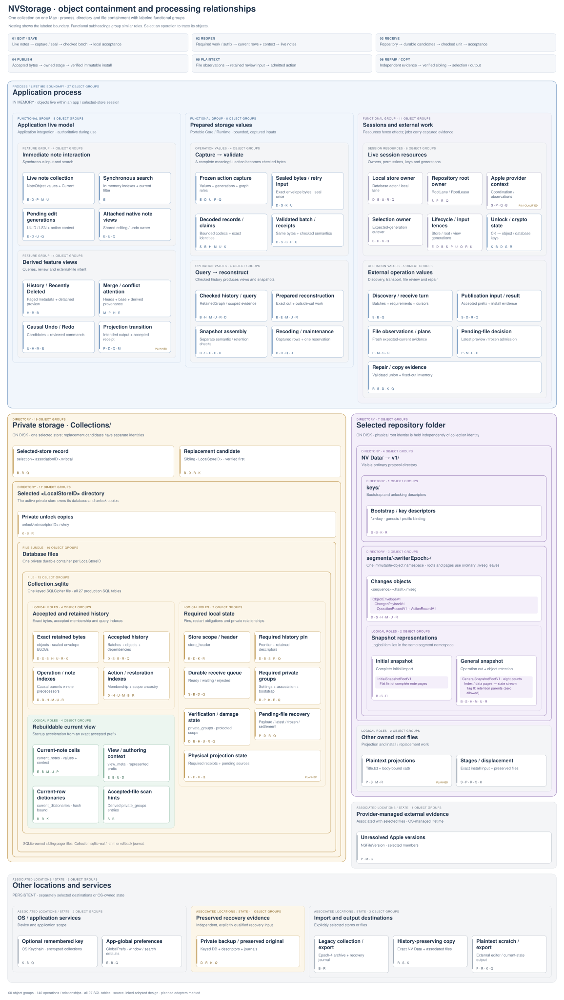

# NVStorage unified object map

Date: 2026-10-14. Explanatory architecture inventory of the adopted [segment](../../CONTEXT.md#2-history-records-and-stored-objects)-[collection](../../CONTEXT.md#1-collections-and-their-copies) design. The normative specification, algorithm/wire annexes, ADRs and vocabulary retain their authority. The diagram includes documented Core, Runtime and Apple work alongside planned [projection](../../CONTEXT.md#7-note-files-and-provider-observations)/application consumers, with implementation and qualification boundaries marked.

[Scenario reference and interactive map](diagrams/nvstorage-object-map.html) · [Scenario document](diagrams/NVStorage-Scenarios.md) · [Full-size SVG](diagrams/nvstorage-object-map.svg) · [Object inventory](diagrams/nvstorage-object-map.json) · [Editable hierarchy and traces](diagrams/nvstorage-object-map.layout.json)

The inventory contains 60 object groups, 140 labeled operations/relationships, and all 27 current private SQL tables. Containment represents process, directory and file boundaries; subheadings identify functional groups. The live in-memory session, private SQL store and provider [repository](../../CONTEXT.md#1-collections-and-their-copies) have distinct responsibilities and boundaries.

Object descriptions use plain language. Technical terms link to the relevant [CONTEXT.md](../../CONTEXT.md) section; the interactive map also shows each definition on hover.

The scenario index contains 48 cases in 7 categories. Each case records initial conditions and an expected outcome, followed by three processing stages with observable state, storage operations and applicable rules. The map highlights objects read/consumed, written/produced, and checked as gates for the selected stage. Object controls open the corresponding inventory details and retain a return path to that stage. Previous/Next, numbered steps and Left/Right keys navigate. Search covers scenario text, object names, requirement IDs and test-contract IDs; the requirement filter covers all 16 registry entries. References link each case to source sections and named conformance contracts. Implementation and platform qualification are recorded in the linked plans and reports.

The architecture-map view emphasizes structure. All SQL roles are nested inside `Collection.sqlite`; pager sidecars are siblings in its database-file bundle. Private unlock copies are outside that bundle, and the selected-store record sits outside either active or replacement store. [Repository](../../CONTEXT.md#1-collections-and-their-copies) descriptors and [segment](../../CONTEXT.md#2-history-records-and-stored-objects) objects sit inside the `NV Data/v1` hierarchy. Snapshot root/page families share the [segment](../../CONTEXT.md#2-history-records-and-stored-objects) namespace. Apple unresolved-version evidence sits outside the physical [repository](../../CONTEXT.md#1-collections-and-their-copies) boundary as associated OS state.

Functional groups say **Feature group**, **[Operation](../../CONTEXT.md#2-history-records-and-stored-objects) values**, **Logical roles**, or **Session resources**. These express similarity and purpose. The enclosing process/directory/file/bundle labels establish physical or lifetime containment. Recovery/output locations have their own explicitly associated boundaries.

Choose an operation trace to highlight its objects and show numbered stages in their existing locations. The trace panel explains what derives or commits each stage and exposes its exact relationships. Clicking one relationship draws that connector alone; clicking a card shows its members, incoming/outgoing operations, features and source contracts. Feature highlighting and object/SQL search preserve the same hierarchy. The interactive view initially fits the map width and scrolls vertically; zoom and whole-map controls support broader inspection.

During use, the complete [live note store](../../CONTEXT.md#1-collections-and-their-copies) is authoritative and search is synchronous. The save route freezes admitted generations, seals exact bytes, validates complete groups, and atomically retains history/acceptance/pin/wakeups. The receive route retains incoming bytes first, waits for the appropriate byte/history requirements, validates and accepts, then prepares [generation-fenced](../../CONTEXT.md#9-authority-repair-and-transitions) [reduction](../../CONTEXT.md#3-history-relationships-and-derived-views). These routes join at [accepted history](../../CONTEXT.md#3-history-relationships-and-derived-views), whose durability precedes external effects.

Private current rows/context accelerate reopening through an exact accepted prefix. [Provider snapshots](../../CONTEXT.md#2-history-records-and-stored-objects) describe a verified [logical operation](../../CONTEXT.md#2-history-records-and-stored-objects) cut; general v1 [retention-parent](../../CONTEXT.md#2-history-records-and-stored-objects) links cover object closures independently. Recovery includes every accepted outside-cut action. Both representations retain their own validation and final-publication checks.

[Operation](../../CONTEXT.md#2-history-records-and-stored-objects) [causal parents](../../CONTEXT.md#3-history-relationships-and-derived-views), [note predecessors](../../CONTEXT.md#3-history-relationships-and-derived-views), action [scope parents](../../CONTEXT.md#3-history-relationships-and-derived-views), [compensation targets](../../CONTEXT.md#6-actions-undo-and-editing), and snapshot retention parents answer separate questions. A pin, stamp, receipt, decoded ID, [upload status](../../CONTEXT.md#7-note-files-and-provider-observations), and [physical permission](../../CONTEXT.md#9-authority-repair-and-transitions) also have distinct issuing and consuming boundaries.

The source corpus contains 124 specification, annex, ADR, plan, validation and coverage documents, including working-tree updates and planned work. The [source manifest](diagrams/nvstorage-object-map.sources.json) records every path and SHA-256 at generation. [Current](../../CONTEXT.md#5-notes-deletion-and-conflict-evidence) adopted contracts govern where earlier experimental reports describe a discarded alternative. Test fixtures, compiler probes and benchmark-only synthetic objects are evidence; scalar ID wrappers, codec cursors and allocation buffers are grouped with their owning records/jobs. The same map applies independently on each Mac.



Feature letters: **E** Editing & search; **D** Local durability; **S** Sync & discovery; **B** Startup & bootstrap; **H** History & [Recently Deleted](../../CONTEXT.md#5-notes-deletion-and-conflict-evidence); **M** Merge & conflicts; **U** Undo / Redo; **P** Plaintext / external files; **K** Encryption & unlocking; **R** Repair / backup / copy; **Q** Quit & lifecycle.

## Scenario reference

[Scenario descriptions and source references](diagrams/NVStorage-Scenarios.md). The following links open individual walkthroughs:

### Local editing, durability and startup

Edit admission and capture, SQL acceptance, accepted-prefix startup, verification replay, and derived-row reconstruction.

- [Local save while the provider is unavailable](diagrams/nvstorage-object-map.html#scenario=offline-save&step=1) — With a healthy, unlocked [private store](../../CONTEXT.md#1-collections-and-their-copies), edits appear immediately. One local database transaction saves their exact history and required records before acknowledgment. Copying that history to the provider can wait.
- [Crash recovery before and after the local commit](diagrams/nvstorage-object-map.html#scenario=save-crash&step=1) — An edit is recoverable after its complete local transaction commits, even if the acknowledgment was lost. Text still held only in memory remains within the pending loss window.
- [Delayed save completion with a newer pending generation](diagrams/nvstorage-object-map.html#scenario=delayed-save&step=1) — Save E captures AB. The user then types C, creating newer edit F with ABC. Completion of E clears only E’s pending work; F stays pending and the displayed text stays ABC.
- [Returning startup with optional snapshot work queued](diagrams/nvstorage-object-map.html#scenario=fast-startup&step=1) — Startup finishes required receive work and unfinished checks, then reads all current notes and editing context together. Independent optional snapshots continue after the complete editable model is published.
- [Startup with positively disclosed but unreadable newer evidence](diagrams/nvstorage-object-map.html#scenario=work-offline&step=1) — Work Offline can open complete local history when startup is waiting for a particular, positively disclosed newer object. Ordinary provider unavailability is a synchronization status and needs no such choice.
- [Reconstruction of invalid derived current rows](diagrams/nvstorage-object-map.html#scenario=derived-rebuild&step=1) — Invalid current-note rows, decoding dictionaries or history-position bindings require rebuilding from healthy retained history. The new view installs together while required private records and pending work stay preserved.
- [Restart during retained-history verification](diagrams/nvstorage-object-map.html#scenario=verification-restart&step=1) — Save a [verification request](../../CONTEXT.md#1-collections-and-their-copies) before checking [accepted history](../../CONTEXT.md#3-history-relationships-and-derived-views) that might be damaged. If checking or recording its result is interrupted, reopening repeats that exact obligation before publishing an editable model.
- [Optional current-row recoding and full-VACUUM maintenance](diagrams/nvstorage-object-map.html#scenario=idle-maintenance&step=1) — Bounded row recoding preserves values and editing context after exact view/history-position checks. Optional full VACUUM needs a healthy idle store, measured benefit, space budgets and qualified interruption behavior. Required saving takes priority.

### Immutable history, merge and deletion

Dependency-aware reception and publication, note-head [reduction](../../CONTEXT.md#3-history-relationships-and-derived-views), causal Delete/edit handling, and snapshot retention ancestry.

- [Receipt of a Delete before its parent edit](diagrams/nvstorage-object-map.html#scenario=child-first&step=1) — Mac B receives Delete D before the edit P that D observes. It saves D and the missing-input wait across restart. When P arrives, B validates and accepts the complete required history before applying the result.
- [Publication retry after an uncertain completion](diagrams/nvstorage-object-map.html#scenario=publication-retry&step=1) — Retry uses the same saved bytes and identity. An equal existing file still needs verification and directory durability steps. Conflicting occupants are preserved; receiving an object twice creates one logical action.
- [Automatic merge of strictly separated line edits](diagrams/nvstorage-object-map.html#scenario=separated-merge&step=1) — Two revisions share one unambiguous base. One changes line 1 and the other line 3, leaving an unchanged line between them. If all fields satisfy the conservative rules, the combined [Current](../../CONTEXT.md#5-notes-deletion-and-conflict-evidence) retains both inputs.
- [Review after overlapping edits or a third head](diagrams/nvstorage-object-map.html#scenario=merge-review&step=1) — Touching or overlapping edits, an ambiguous base, a third revision or the two-sided line limit require review. Every alternative stays available. A prepared choice must still match the complete current inputs when admitted.
- [Ordinary editing of one unresolved head](diagrams/nvstorage-object-map.html#scenario=ordinary-conflict-edit&step=1) — Editing displayed revision A replaces the represented A input. Known conflicting revision B stays unresolved. Releasing the temporary editing pin schedules computation from the full set of applicable [note heads](../../CONTEXT.md#5-notes-deletion-and-conflict-evidence).
- [Concurrent Delete and offline edit on separate Macs](diagrams/nvstorage-object-map.html#scenario=delete-race&step=1) — Delete D and edit E are created independently from the same note. History [reduction](../../CONTEXT.md#3-history-relationships-and-derived-views) deletes the old [note birth](../../CONTEXT.md#5-notes-deletion-and-conflict-evidence) and preserves eligible concurrent E in a deterministic [conflict note](../../CONTEXT.md#5-notes-deletion-and-conflict-evidence). An edit already observed by D is covered instead.
- [Retraction after a later Delete covers a preserved edit](diagrams/nvstorage-object-map.html#scenario=retracted-copy&step=1) — Delete concurrent with E creates automatic [conflict note](../../CONTEXT.md#5-notes-deletion-and-conflict-evidence) C. A later Delete observing E can remove untouched C when no eligible source remains. Independent edits to C and still-eligible descendants of E survive.
- [Snapshot state and required parent objects](diagrams/nvstorage-object-map.html#scenario=snapshot-retention&step=1) — A general v1 snapshot can name an accepted parent snapshot independently of the history represented by its values. Acceptance updates the required-object frontier together. Parent objects and all accepted operations outside the snapshot’s represented history stay available.

### History, restoration and compensation

Historical field recovery, [fresh-birth](../../CONTEXT.md#5-notes-deletion-and-conflict-evidence) Restore, [causal Undo/Redo](../../CONTEXT.md#6-actions-undo-and-editing), native [remaining-effect coverage](../../CONTEXT.md#6-actions-undo-and-editing), and shared-window ownership.

- [Historical body restoration with current title and labels](diagrams/nvstorage-object-map.html#scenario=selective-history&step=1) — [Note History](../../CONTEXT.md#5-notes-deletion-and-conflict-evidence) can supply an older body for a new recovery action. [Current](../../CONTEXT.md#5-notes-deletion-and-conflict-evidence) title and labels stay unchanged unless explicitly selected. Admission checks the complete preview and current note again.
- [Named restoration followed by deletion of the fresh birth](diagrams/nvstorage-object-map.html#scenario=recently-deleted&step=1) — Restore creates a new [note birth](../../CONTEXT.md#5-notes-deletion-and-conflict-evidence) linked to the selected deleted entry. Only complete durable [restoration](../../CONTEXT.md#5-notes-deletion-and-conflict-evidence) evidence removes that source entry from the default list. Deleting the restored note creates a separate entry.
- [Causal Undo after relaunch or on another Mac](diagrams/nvstorage-object-map.html#scenario=portable-undo&step=1) — Saved [action records](../../CONTEXT.md#2-history-records-and-stored-objects) retain their members, before/after values and Undo relationships. Any Mac can reverse an eligible action when it is the sole candidate at the end of the relevant Undo relationships. Concurrent or overlapping candidates need review; a bulk action is admitted as a complete group.
- [Reviewed Undo with an actual-current inverse](diagrams/nvstorage-object-map.html#scenario=reviewed-undo&step=1) — Rename B changed Shopping to Groceries, while a represented concurrent action made [Current](../../CONTEXT.md#5-notes-deletion-and-conflict-evidence) Errands. Approved Undo B records Errands to Shopping. Redo reverses that actual [compensation](../../CONTEXT.md#6-actions-undo-and-editing) back to Errands.
- [Concurrent compensation of the same action](diagrams/nvstorage-object-map.html#scenario=concurrent-undo&step=1) — Two Macs can each reverse X before learning of the other’s action. Both compensations stay in history. Review depends on the requested Undo/Redo family and current values; reversing one restored note preserves the other.
- [Partial native Undo followed by relaunch](diagrams/nvstorage-object-map.html#scenario=native-remaining&step=1) — Partial native Undo saves which effects of a typing action remain. Reopening uses that record and [Current](../../CONTEXT.md#5-notes-deletion-and-conflict-evidence)’s history to determine [portable Undo](../../CONTEXT.md#6-actions-undo-and-editing) eligibility, so an already reversed effect is not reversed twice.
- [Shared-note windows during composition and remote publication](diagrams/nvstorage-object-map.html#scenario=shared-windows&step=1) — Two windows share one live note and its Undo owner while keeping independent selections. A remote body update waits for an applicable native input boundary and checks the note, attachment, store, root and lifecycle versions again.
- [Dedicated saved-search windows and bookmark preferences](diagrams/nvstorage-object-map.html#scenario=saved-search-windows&step=1) — Each saved search reuses its own ordinary window over the shared [collection](../../CONTEXT.md#1-collections-and-their-copies). Activating one preserves the other windows’ searches and selections. Bookmark preferences retain its frame and open state across launches.
- [Durable preservation of a selected unresolved revision](diagrams/nvstorage-object-map.html#scenario=conflict-copy&step=1) — [Save as new note](../../CONTEXT.md#8-explicit-conflict-choices) records the exact copy and [disposition](../../CONTEXT.md#8-explicit-conflict-choices) for a selected revision while preserving the source history. Independent explicit copies can create different note births. Completed disposition survives later edits or deletion of the copy.

### Plaintext files and external versions

[File observation](../../CONTEXT.md#7-note-files-and-provider-observations) and provenance, automatic import, pending input retention, [projection](../../CONTEXT.md#7-note-files-and-provider-observations) installation, external deletion, and Apple version [disposition](../../CONTEXT.md#8-explicit-conflict-choices).

- [Automatic import of an eligible ordinary text file](diagrams/nvstorage-object-map.html#scenario=automatic-import&step=1) — An ordinary unstamped file imports after its origin, availability and narrowly defined repair candidates are checked. One admitted observation keeps the same retry identity. Later discovery of a duplicate preserves independently created notes.
- [Projection stamp arriving before its named history](diagrams/nvstorage-object-map.html#scenario=stamp-waits&step=1) — A [projection stamp](../../CONTEXT.md#7-note-files-and-provider-observations) can name history that has not arrived yet. NV keeps the file and waits for that exact evidence. Once the represented state and unique association match current bytes, it associates the file without recording a duplicate edit.
- [Source change before external-file choice admission](diagrams/nvstorage-object-map.html#scenario=pending-choice&step=1) — A choice previews A, then another editor saves B before approval. NV durably replaces the latest preview after checking its version. The old preparation for A becomes stale and cannot reuse its consent for B.
- [Source change after external-file operation admission](diagrams/nvstorage-object-map.html#scenario=admitted-file&step=1) — An admitted operation keeps frozen input A while newer B becomes a later observation. After restart, exact saved action evidence determines whether A committed. Receipt recovery continues the same operation and [note birth](../../CONTEXT.md#5-notes-deletion-and-conflict-evidence).
- [Disappearance of an unadmitted pending external file](diagrams/nvstorage-object-map.html#scenario=disappeared-file&step=1) — The last durably retained readable file snapshot survives later disappearance or unreadability. Its bytes remain available for a fresh applicable decision or explicit recovery. Association and physical changes still need fresh evidence.
- [External disappearance during deletion confirmation](diagrams/nvstorage-object-map.html#scenario=external-deletion&step=1) — A missing note file can trigger the configured deletion choice. File return, changed [Current](../../CONTEXT.md#5-notes-deletion-and-conflict-evidence) or a received Delete can invalidate that choice. A new local Delete needs fresh admission and its complete local save barrier.
- [New projection intent C while installation B is unfinished](diagrams/nvstorage-object-map.html#scenario=projection-abc&step=1) — A is the verified note file when update B starts. New intent C arrives before B finishes. B settles only its own output and captured edit versions; C stays pending until its own applicable installation.
- [Scoped disposition of an Apple unresolved version](diagrams/nvstorage-object-map.html#scenario=apple-versions&step=1) — Resolving captured Apple version V requires admission, complete local history durability, exact plaintext installation and final coordinated checks. Only still-applicable captured members are marked resolved, followed by a fresh query.
- [External-editor handoff from an encrypted collection](diagrams/nvstorage-object-map.html#scenario=external-editor&step=1) — An explicit handoff creates owned plaintext scratch outside the provider folder and discloses external-app retention risks. Returned edits use the ordinary local save barrier. Cleanup applies only to the exact serviced scratch generation.

### Damage classification, repair and backup

Same-root [repository](../../CONTEXT.md#1-collections-and-their-copies) repair, retained-history reconstruction, fresh-store activation, bootstrap, and complete private backups.

- [Automatic repair of positively absent same-root NV Data](diagrams/nvstorage-object-map.html#scenario=repository-repair&step=1) — If the same owned root has lost [NV Data](../../CONTEXT.md#1-collections-and-their-copies), a complete private copy can reconstruct it automatically when no unread newer evidence is disclosed. Exclusive creation preserves a competing directory or file that appears meanwhile.
- [Fresh-store repair from complementary retained copies](diagrams/nvstorage-object-map.html#scenario=private-repair&step=1) — The surviving [retained-history pin](../../CONTEXT.md#2-history-records-and-stored-objects) requires G+L+R. Private history supplies G+L and the [repository](../../CONTEXT.md#1-collections-and-their-copies) supplies G+R. Their validated union builds a separate replacement; complete history and the pin must be durable before activation.
- [Required retained object missing from all available sources](diagrams/nvstorage-object-map.html#scenario=missing-history&step=1) — A surviving pin names required history missing from the [private store](../../CONTEXT.md#1-collections-and-their-copies), [repository](../../CONTEXT.md#1-collections-and-their-copies) and selected backup. Readable current-note rows cannot waive that obligation. Editable publication needs complete repair or an explicit recovery outcome.
- [Fresh private-store bootstrap from a selected repository](diagrams/nvstorage-object-map.html#scenario=fresh-mac&step=1) — A new Mac, or total loss of private state, needs explicit folder association and complete verified [collection](../../CONTEXT.md#1-collections-and-their-copies)-bootstrap history. A verified snapshot can support read-only preview while editing waits for required history and a durable new local pin.
- [Private backup containing unpublished and pending work](diagrams/nvstorage-object-map.html#scenario=private-backup&step=1) — A consistent SQLite backup or stopped-writer copy of the complete database and required journals includes unpublished history, private records and pending file inputs. Usable unlocking descriptors accompany encrypted backups. Restore establishes fresh ownership.

### Encryption profiles and credentials

Password/key recovery, add-only key wrapping, authenticated decoding, and explicitly requested plaintext output.

- [Password unlock with an unavailable remembered key](diagrams/nvstorage-object-map.html#scenario=unlock&step=1) — If Keychain is unavailable, a usable wrapped-key descriptor and authorized password can recover the same [collection](../../CONTEXT.md#1-collections-and-their-copies) key. Remembering it requires add-only Keychain creation and verified readback before the association references the new item.
- [Same-key password rewrap and full key/profile conversion](diagrams/nvstorage-object-map.html#scenario=password-rewrap&step=1) — Changing a password adds another wrapping of the existing [collection](../../CONTEXT.md#1-collections-and-their-copies) key while retaining history and old descriptors. A full key/profile change uses a separate destination, verifies output and credentials, and preserves the source until cutover.
- [Encrypted history, plaintext output and conversion limits](diagrams/nvstorage-object-map.html#scenario=privacy-profile&step=1) — The encrypted profile protects current, historical and deleted values and governs previews and diagnostics. Explicit plaintext output has a disclosed scope and destination. Unsupported rich-text or attachment conversion preserves the source.

### Root ownership and collection transitions

[Repository copy](../../CONTEXT.md#9-authority-repair-and-transitions), current-note recovery export, root moves, close ordering, [collection](../../CONTEXT.md#1-collections-and-their-copies) switching, and epoch-4 migration.

- [Repository copy with unavailable entries and no private store](diagrams/nvstorage-object-map.html#scenario=repository-copy&step=1) — Copy captures available immutable history, descriptors and associated unknown files. It reports unreadable placeholders or inputs that changed. The source Mac’s Application Support data is outside this [repository](../../CONTEXT.md#1-collections-and-their-copies)-copy boundary.
- [Current-note recovery after local acceptance failure](diagrams/nvstorage-object-map.html#scenario=unsaved-recovery&step=1) — An admitted edit stays visible when its local save barrier fails. Retry keeps the exact pending identity. Recovery export must include consistent live pending values and verify a fresh destination before releasing source work.
- [Close with local work pending and provider work stalled](diagrams/nvstorage-object-map.html#scenario=quit-offline&step=1) — One close owner stops new edits and saves complete admitted actions and required private state. After local durability, Quit Without Waiting preserves unpublished history and restartable note-file intent. Failure of rebuildable current rows alone does not block close.
- [Root move followed by replacement at the old pathname](diagrams/nvstorage-object-map.html#scenario=root-move&step=1) — Ownership follows the same physical directory through a move. A different directory at the old path remains separate even if its [collection identity](../../CONTEXT.md#1-collections-and-their-copies) and bytes match. Delayed operations recheck their captured physical and session context.
- [Collection switch, cancellation and late completion](diagrams/nvstorage-object-map.html#scenario=collection-switch&step=1) — One transition owner finishes source work and verifies the chosen destination before changing the association. Cancellation resumes editing only when healthy. Late callbacks retain their original session and cannot change the new [collection](../../CONTEXT.md#1-collections-and-their-copies).
- [Verified migration from recovered epoch-4 state](diagrams/nvstorage-object-map.html#scenario=legacy-migration&step=1) — Migration first recovers and consistently captures legacy current values. Verify the new [collection](../../CONTEXT.md#1-collections-and-their-copies)’s complete initial history, snapshot, required output and credentials before changing the association. Failure preserves the legacy source.

## Operation traces

### Edit → local durability

Edits appear immediately, then complete actions are frozen, encoded and checked. One private transaction saves the exact history and every required related record.

1. **Admit the edit.** The [live note store](../../CONTEXT.md#1-collections-and-their-copies) changes immediately; a local version identifies each pending edit. Objects: `live`, `pendinglive`.
2. **Freeze and encode once.** Capture the complete action and fix the exact bytes that saving and retry will use. Objects: `capture`, `seal`.
3. **Check history consistency.** Validate against a checked current-state basis or the complete declared history. Objects: `decoded`, `graph`, `batch`.
4. **Commit locally.** Save exact bytes, accepted membership, indexes and all required history together; acknowledge only the captured edit versions. Objects: `objects`, `accepted`, `pin`, `opindex`, `actionindex`.

### Private current rows → live model

Open and unlock the owned [private store](../../CONTEXT.md#1-collections-and-their-copies), finish required receive/check work, and bring current rows through any new [accepted history](../../CONTEXT.md#3-history-relationships-and-derived-views). Read all current values and editing context together. Invalid rows or unfinished verification take their required rebuild/check path.

1. **Unlock and check the selected store.** Recover a usable key, open the database and check its selected-store and [collection](../../CONTEXT.md#1-collections-and-their-copies)-bootstrap bindings. Objects: `unlock`, `keychain`, `secrets`, `dbcontainer`, `header`, `localowner`.
2. **Finish required work / update current rows.** Handle required Changes and prerequisites, repeat unfinished checks, and bring current rows through the [accepted history](../../CONTEXT.md#3-history-relationships-and-derived-views). Optional independent snapshots stay queued until the model is published. A healthy settled launch reads only the current state and required indexed work. Objects: `receiveq`, `recvwork`, `accepted`, `verification`, `reduce`.
3. **Read complete values and editing context.** One consistent read captures all current bodies, editing frontiers, the view version and represented history position. Invalid rows or decoding metadata require reconstruction from healthy retained history. Objects: `current`, `view`, `dict`.
4. **Publish the complete app model.** Construct all notes and search state. Recheck the owner, lifecycle, view version and accepted/current-row history positions before making the complete model visible. Search remains synchronous. Objects: `live`, `search`, `gate`.

### Repository → accepted history

Discovery supplies possible incoming objects. Store their exact bytes, wait for required inputs, validate the complete history unit, and then accept it. Arrival order supplies no causal ordering.

1. **Discover and read objects.** Bounded reads from the owned [repository](../../CONTEXT.md#1-collections-and-their-copies) capture exact candidate bytes. Objects: `rkeys`, `rchanges`, `rinitial`, `rgeneral`, `recvwork`, `rootowner`.
2. **Keep bytes before accepting history.** Save incoming bytes and their ready, waiting or rejected status so receive work survives restart. Objects: `objects`, `receiveq`.
3. **Check the complete history unit.** Resolve required inputs and check protection, history relationships and complete [action groups](../../CONTEXT.md#2-history-records-and-stored-objects). Objects: `decoded`, `graph`, `snapwork`, `batch`.
4. **Accept history and update the model.** Commit [accepted history](../../CONTEXT.md#3-history-relationships-and-derived-views) and the [retained-history pin](../../CONTEXT.md#2-history-records-and-stored-objects) together. Check the current live generation before publishing prepared model changes. Objects: `accepted`, `pin`, `reduce`, `live`.

### Accepted bytes → repository

Copy exact locally durable objects into the [repository](../../CONTEXT.md#1-collections-and-their-copies) through owned temporary files. Verify the final installation and complete the required durability steps.

1. **Select exact saved objects.** Capture the [accepted history](../../CONTEXT.md#3-history-relationships-and-derived-views) position, exact retained bytes and all required related objects. Objects: `accepted`, `objects`, `pubwork`.
2. **Own the complete temporary output.** Entered work retains its exact retry bytes and permission for the same physical directory. Objects: `rstages`, `rootowner`, `appleowner`.
3. **Install and verify [immutable objects](../../CONTEXT.md#2-history-records-and-stored-objects).** Use exclusive creation, check exact bytes, and complete the qualified file and directory durability steps. Objects: `rkeys`, `rchanges`, `rinitial`, `rgeneral`.

### External file → admitted operation

Fresh file observations and explicit choices preserve external input before admitting an import or associated update.

1. **Read the exact selected files.** Capture fresh file observations and selected bodies, including explicitly disclosed Apple versions. Objects: `rnotes`, `appleversions`, `filework`.
2. **Keep and review the input.** Preserve the latest preview, frozen inputs for admitted operations and required note/file relationships separately. Objects: `pendingwork`, `pendingdisk`, `projectiondisk`.
3. **Admit the applicable action.** Admit the reviewed import, update or recovery through the ordinary complete local history transaction. Objects: `capture`, `batch`.
4. **Update the note file.** Capture intended output, check the expected current file before replacement, then retain the verified association. Objects: `live`, `projection`, `rstages`.

### Independent evidence → verified replacement

Combine independently validated surviving history and required private records. Build a separate replacement store and reopen it successfully before changing the active selection.

1. **Capture surviving evidence.** Preserve exact local, [repository](../../CONTEXT.md#1-collections-and-their-copies) and selected backup inputs with consistent required private records. Objects: `objects`, `pin`, `private`, `pendingdisk`, `projectiondisk`, `backup`, `rchanges`, `rkeys`.
2. **Verify the combined inputs.** Check exact bytes, all required history, private records and captured copy inventories. Objects: `repairwork`.
3. **Build and reopen the replacement.** Reconstruct a fresh [private store](../../CONTEXT.md#1-collections-and-their-copies) and verify reopening with usable recovery credentials. Objects: `candidate`, `selectowner`.
4. **Activate or copy explicitly.** Changing selection checks its expected version. A separately requested copy preserves the captured history in its own destination. Objects: `selection`, `copy`, `localowner`.

## Nested object inventory

The following inventory follows the diagram hierarchy. Each object appears once; its container path distinguishes physical nesting from the labeled functional groups.

### Application process

IN MEMORY · objects live within an app / selected-store session.

#### Application live model

Application integration · authoritative during use.

##### Immediate note interaction

Synchronous input and search.

###### live — Authoritative live note collection

**In memory · value or job** · Features E, D, P, M, U.

Container / grouping path: Application process › Application live model › Immediate note interaction.

Edits enter the complete [live note store](../../CONTEXT.md#1-collections-and-their-copies) immediately. Incoming prepared changes become visible together after final checks. Pending edits stay protected until their exact history is durably saved.

- Shared current notes title/body/labels/format/dates
- [Current](../../CONTEXT.md#5-notes-deletion-and-conflict-evidence) represented revision/equal/merge inputs
- Applied operation frontier
- [Automatic preservation](../../CONTEXT.md#5-notes-deletion-and-conflict-evidence) births / independently edited conflict notes
- Temporary local Current-head/presentation pin

Boundary: Adopted design; implementation scope is documented by the cited plans.

Sources: [iCloud-Drive-Support-Spec.md](../iCloud-Drive-Support-Spec.md), [CONTEXT.md](../../CONTEXT.md), [Implementation.md](Implementation.md).

###### search — Synchronous search / live indexes

**In memory · value or job** · Features E.

Container / grouping path: Application process › Application live model › Immediate note interaction.

All current notes and search indexes are ready before editable startup. Searching and filtering run synchronously with input processing and the same view-refresh cycle.

- Complete current-note/search model
- UUID, label lookup and sorting structures
- Window query/filter/list selection
- Host case-insensitive label lookup distinct from exact stored label tokens

Boundary: Adopted design; implementation scope is documented by the cited plans.

Sources: [iCloud-Drive-Support-Spec.md](../iCloud-Drive-Support-Spec.md), [first-save-reopen-contract.md](plan/first-save-reopen-contract.md), [Window-UI-Architecture.md](Window-UI-Architecture.md).

###### pendinglive — Pending edit versions and action context

**In memory · value or job** · Features E, D, U, Q.

Container / grouping path: Application process › Application live model › Immediate note interaction.

Each pending edit records the version and action context needed to save it faithfully. Completion clears only the generations it actually saved. A fresh editable session creates new writer-epoch and [action-origin](../../CONTEXT.md#6-actions-undo-and-editing) contexts.

- Existing pending changed/deleted UUID/LSN work
- Earlier admitted pending predecessor operations/actions
- Open saved-edit group and exact before-state
- [Writer epoch](../../CONTEXT.md#2-history-records-and-stored-objects) / sequence allocator
- Fresh independent [action origin](../../CONTEXT.md#6-actions-undo-and-editing) / previous-origin action

Boundary: Adopted design; implementation scope is documented by the cited plans.

Sources: [Protocol.md](Protocol.md), [Implementation.md](Implementation.md), [swift-storage-library-proposal-v2.md](plan/swift-storage-library-proposal-v2.md).

###### views — Native undo + attached note views

**In memory · value or job** · Features E, U, Q.

Container / grouping path: Application process › Application live model › Immediate note interaction.

Windows share the live note and its Undo owner while keeping their own presentation state. [Native typing undo](../../CONTEXT.md#6-actions-undo-and-editing) checks causal eligibility. Durable [action records](../../CONTEXT.md#2-history-records-and-stored-objects) retain the [remaining effects](../../CONTEXT.md#6-actions-undo-and-editing) needed for [portable Undo](../../CONTEXT.md#6-actions-undo-and-editing).

- NSUndoManager executable groups/ranges and selections
- NativeSavedEffect / NativeCompensationStep [remaining effects](../../CONTEXT.md#6-actions-undo-and-editing)
- Shared live text/model owner and NSTextStorage adapter
- Generation-tagged note view attachments
- Window focus/selection/scroll/layout/geometry
- AppKit-managed marked input

Boundary: Adopted ownership/input contract; native bridge candidates and actual application integration remain distinct gates.

Sources: [iCloud-Drive-Support-Spec.md](../iCloud-Drive-Support-Spec.md), [Window-UI-Architecture.md](Window-UI-Architecture.md), [Native-Undo-Experiments.md](Native-Undo-Experiments.md).

##### Derived feature views

Queries, review and external-file intent.

###### history — History / Recently Deleted views

**In memory · value or job** · Features H, R, B.

Container / grouping path: Application process › Application live model › Derived feature views.

On-demand indexed queries load exact retained history. Durable [restoration](../../CONTEXT.md#5-notes-deletion-and-conflict-evidence) evidence removes only its named source entry from [Recently Deleted](../../CONTEXT.md#5-notes-deletion-and-conflict-evidence), even if the restored note is later deleted.

- HistoryQuery / Cursor / Entry / Page
- HistoryPreview / HistoricalNoteState
- [Recently Deleted](../../CONTEXT.md#5-notes-deletion-and-conflict-evidence) source-deletion entries
- Retained branch and merge previews/diff buffers
- CapturedRestoration [fresh-birth](../../CONTEXT.md#5-notes-deletion-and-conflict-evidence) command

Boundary: Adopted design; implementation scope is documented by the cited plans.

Sources: [Protocol.md](Protocol.md), [phase3-history-validation.md](plan/phase3-history-validation.md), [restoration-record-contract.md](plan/restoration-record-contract.md), [Window-UI-Architecture.md](Window-UI-Architecture.md).

###### conflicts — Derived merges / conflict attention

**In memory · value or job** · Features M, P, H, E.

Container / grouping path: Application process › Application live model › Derived feature views.

[Note predecessors](../../CONTEXT.md#3-history-relationships-and-derived-views) determine alternative [note heads](../../CONTEXT.md#5-notes-deletion-and-conflict-evidence) and [Current](../../CONTEXT.md#5-notes-deletion-and-conflict-evidence). Conservative merging preserves the exact inputs and base. [Copy disposition](../../CONTEXT.md#8-explicit-conflict-choices) changes attention to selected conflicts; Apple version choices retain their separate scope.

- NoteReductionV1 / ReducedNoteValueV1
- DerivedMergeV1 / MergeID / DerivedStateReferenceV1
- UncoveredMaximalEdits and [automatic preservation](../../CONTEXT.md#5-notes-deletion-and-conflict-evidence) identities
- Recovery key / slot / retired deterministic identity
- Unresolved NV attention minus exact completed copies
- Invocation-scoped resolver [Current](../../CONTEXT.md#5-notes-deletion-and-conflict-evidence) and selected member previews

Boundary: Adopted design; implementation scope is documented by the cited plans.

Sources: [Protocol.md](Protocol.md), [conservative-merge-contract.md](plan/conservative-merge-contract.md), [derived-state-reference-contract.md](plan/derived-state-reference-contract.md), [Implementation.md](Implementation.md).

###### undo — Causal Undo/Redo / reviewed commands

**In memory · value or job** · Features U, H, M, E.

Container / grouping path: Application process › Application live model › Derived feature views.

[Scope parents](../../CONTEXT.md#3-history-relationships-and-derived-views) order Undo/Redo candidates; [compensation targets](../../CONTEXT.md#6-actions-undo-and-editing) identify the action being reversed. Preparation and admission check the complete command again. Execution records a new action rather than rewriting earlier history.

- CausalUndoSelectionV1 / UndoCandidates
- CompensationProposal / CompensationEffect
- AutomaticCompensation / CompensationReview
- Candidate frontier, selected action and affected values
- Native remaining-effect claims
- Invocation-scoped explicit approval context

Boundary: Adopted design; implementation scope is documented by the cited plans.

Sources: [Protocol.md](Protocol.md), [swift-storage-library-proposal-v2.md](plan/swift-storage-library-proposal-v2.md), [phase3-connected-record-contract.md](plan/phase3-connected-record-contract.md).

###### projection — Note-file update in progress

**In memory · value or job** · Features P, D, Q, M.

Container / grouping path: Application process › Application live model › Derived feature views.

An unfinished note-file update retains the last verified representation for repair matching. If B finishes while newer C is pending, B settles only its own work. A [projection receipt](../../CONTEXT.md#7-note-files-and-provider-observations) advances after exact file verification and completed source accounting.

- Generation-tagged [accepted projection](../../CONTEXT.md#7-note-files-and-provider-observations) receipt
- [Current](../../CONTEXT.md#5-notes-deletion-and-conflict-evidence) intended filename/format/exact bytes
- Captured in-flight output and original expected source
- Pending source-accounting obligation
- [Active projection comparison set](../../CONTEXT.md#7-note-files-and-provider-observations)

Boundary: Adopted contract; application/[projection](../../CONTEXT.md#7-note-files-and-provider-observations) consumers remain Phases 6–7.

Sources: [Protocol.md](Protocol.md), [iCloud-Drive-Support-Spec.md](../iCloud-Drive-Support-Spec.md).

#### Prepared storage values

Portable Core / Runtime · bounded inputs captured for a job.

##### Capture → validate

Freeze complete actions and check their encoded history.

###### capture — Frozen edit and action captures

**In memory · value or job** · Features E, D, U, P, Q.

Container / grouping path: Application process › Prepared storage values › Capture → validate.

The main-thread bridge freezes complete values and action context after an edit is admitted. Background work preserves those identities and group boundaries through encoding, retry and local commit.

- CapturedActionGroup and CapturedActionIntent
- CapturedNoteGeneration UUID/LSN
- PlaintextNoteValue / NoteValueV1
- CausalParentSet and NotePredecessorSet
- [Action frontier](../../CONTEXT.md#6-actions-undo-and-editing), before/after values and [restoration](../../CONTEXT.md#5-notes-deletion-and-conflict-evidence)/merge/native-Undo references
- DependencyLocatorTable

Boundary: Adopted design; implementation scope is documented by the cited plans.

Sources: [first-save-reopen-contract.md](plan/first-save-reopen-contract.md), [swift-storage-library-proposal-v2.md](plan/swift-storage-library-proposal-v2.md).

###### seal — Fixed object bytes for saving and retry

**In memory · value or job** · Features D, S, K, U.

Container / grouping path: Application process › Prepared storage values › Capture → validate.

Encoding, optional compression and integrity/encryption protection fix an object’s final bytes once. Retry uses the same [sealed object](../../CONTEXT.md#4-change-processing-and-durability); uncertain completion is checked against the committed identity.

- ObjectEnvelopeV1 exact bytes and SegmentLocator
- ImmutableRepositoryObject / Locator
- Compression and AEAD worker buffers
- OwnedCommit / CommitHandle
- SnapshotCommitHandle

Boundary: Adopted design; implementation scope is documented by the cited plans.

Sources: [Protocol.md](Protocol.md), [Encryption.md](Encryption.md), [typed-runtime-boundaries-validation.md](plan/typed-runtime-boundaries-validation.md).

###### decoded — Decoded records awaiting history checks

**In memory · value or job** · Features S, B, H, M, U, K.

Container / grouping path: Application process › Prepared storage values › Capture → validate.

Decoding checks protection and size limits before constructing complete records. Their identities and references then supply inputs for checking history meaning and consistency.

- HashChecked / authenticated [envelope](../../CONTEXT.md#2-history-records-and-stored-objects) facts
- OperationRecordV1 / IdentifiedOperation
- ActionRecordV1, before/after/reference variants
- Initial/general snapshot root/page/record values
- [Projection](../../CONTEXT.md#7-note-files-and-provider-observations) / pending / private record decodes
- ExactUTF8, labels, display dates and nominal ID wrappers

Boundary: Adopted design; implementation scope is documented by the cited plans.

Sources: [Encryption.md](Encryption.md), [swift-storage-library-proposal-v2.md](plan/swift-storage-library-proposal-v2.md), [first-save-reopen-contract.md](plan/first-save-reopen-contract.md).

###### batch — Validated batch and durability results

**In memory · value or job** · Features D, S, B, R, U.

Container / grouping path: Application process › Prepared storage values › Capture → validate.

History validation produces a batch tied to its checked bootstrap, current-state basis or declared history. The database owner checks that context again and commits all acceptance records before issuing a [durability acknowledgment](../../CONTEXT.md#4-change-processing-and-durability).

- HistoryObject exact bytes with decoded contents
- ValidatedHistoryBatch issuer-private input
- AcceptedHistoryReceipt
- AcceptedSnapshotReceipt
- Exact covered-generation commit outcome

Boundary: Adopted design; implementation scope is documented by the cited plans.

Sources: [swift-storage-library-proposal-v2.md](plan/swift-storage-library-proposal-v2.md), [typed-runtime-boundaries-validation.md](plan/typed-runtime-boundaries-validation.md), [phase4-snapshot-acceptance-validation.md](plan/phase4-snapshot-acceptance-validation.md).

##### Query → reconstruct

Checked history supplies views and snapshots.

###### graph — Checked history and query results

**In memory · value or job** · Features B, H, M, U, R, D.

Container / grouping path: Application process › Prepared storage values › Query → reconstruct.

Indexed reads check complete action membership and history relationships while decoding each object once. Query evidence records the owner, session and history/view position checked. Full-history evidence supports reconstruction and [collection](../../CONTEXT.md#1-collections-and-their-copies)-wide commands.

- CheckedHistoryTraversal / CheckedGraphRows
- CheckedEnvelopeRecords
- [Operation](../../CONTEXT.md#2-history-records-and-stored-objects) causal ancestry and note-predecessor graph
- [Action origin](../../CONTEXT.md#6-actions-undo-and-editing)/scope/[compensation](../../CONTEXT.md#6-actions-undo-and-editing)/native-coverage graph
- [Current](../../CONTEXT.md#5-notes-deletion-and-conflict-evidence)/context capture, exact occurrence coverage
- CheckedCurrentBasis for qualifying ordinary saves

Boundary: Adopted design; implementation scope is documented by the cited plans.

Sources: [swift-storage-library-proposal-v2.md](plan/swift-storage-library-proposal-v2.md), [at-most-once-envelope-decoding.md](plan/phase-4-improvements/at-most-once-envelope-decoding.md), [startup-and-scoped-queries.md](plan/phase-4-improvements/startup-and-scoped-queries.md).

###### reduce — Prepared current-state computation

**In memory · value or job** · Features B, E, M, U, R.

Container / grouping path: Application process › Prepared storage values › Query → reconstruct.

[Reduction](../../CONTEXT.md#3-history-relationships-and-derived-views) computes current notes and related views separately from live editing and database writes. Installation checks the starting view and target history again. Publishing to the app separately checks that its live context still matches.

- PreparedModelChange
- PreparedReconstruction / recovery basis
- Affected CurrentNoteCellV1 rows
- AuthoringContextV1
- StoreSnapshot checked complete capture
- One-shot opening handoff

Boundary: Adopted design; implementation scope is documented by the cited plans.

Sources: [LocalStore.md](LocalStore.md), [phase4-bootstrap-reconstruction-plan.md](plan/phase4-bootstrap-reconstruction-plan.md), [swift-storage-library-proposal-v2.md](plan/swift-storage-library-proposal-v2.md).

###### snapwork — Snapshot capture and validation

**In memory · value or job** · Features B, S, R, H, U.

Container / grouping path: Application process › Prepared storage values › Query → reconstruct.

Snapshot capture builds bounded roots and pages incrementally. Assembly checks the entire page tree, counts and digest. Separate checks verify the represented history and the required objects named by snapshot retention parents.

- InitialCollectionV1 / BootstrapCandidate
- InitialBootstrapValidationV1 / checked action frontiers
- GeneralSnapshotCapture / PreviewV1
- VerifiedGeneralSnapshotClaims
- CheckedRetentionParents / CheckedSnapshotAcceptance
- Page-stream readers, hashing and owned sink buffers

Boundary: Adopted design; implementation scope is documented by the cited plans.

Sources: [general-snapshot-record-contract.md](plan/general-snapshot-record-contract.md), [phase4-bootstrap-reconstruction-plan.md](plan/phase4-bootstrap-reconstruction-plan.md).

###### maintenance — Recoding / maintenance job state

**In memory · value or job** · Features B, R, Q, D.

Container / grouping path: Application process › Prepared storage values › Query → reconstruct.

Optional jobs recode a bounded set of current rows or compact the database. They check captured row/view versions and retain resources until completion or rollback settles. Automatic training, recoding, VACUUM and read-ahead each have their own qualification gates.

- EncodedCurrentRows preparation
- Captured logical/physical current rows
- Per-session training-attempt marker
- MaintenanceState and unique cancellation identity
- VacuumBudget / VacuumOutcome

Boundary: Adopted design; implementation scope is documented by the cited plans.

Sources: [private-current-row-codec.md](plan/private-current-row-codec.md), [phase4-current-row-locality-maintenance-plan.md](plan/phase4-current-row-locality-maintenance-plan.md).

#### Sessions and external work

Session resources govern file work; jobs retain captured inputs.

##### Live session resources

Owners, permissions, keys and captured versions.

###### localowner — Local store / database owner

**In memory · revocable owner/context** · Features D, B, U, R, Q.

Container / grouping path: Application process › Sessions and external work › Live session resources.

One owner serializes database work and reserves jobs before waiting. Separate background preparation and provider resources leave local saving able to proceed.

- Exclusive private-directory owner/lease
- Database / DatabaseLane and keyed connection
- StorageExecutor, HistoryWorker, CommandWorker
- LocalStoreLifecycle / LocalCommitState / OwnedCommit
- ReceiveWorkState and completion waiters
- Borrowed statement/C resources with scoped final disposal
- SQLite pager cache and keyed connections
- Fixed-cut SQLite backup connection and job ownership

Boundary: Adopted design; implementation scope is documented by the cited plans.

Sources: [swift-storage-library-proposal-v2.md](plan/swift-storage-library-proposal-v2.md), [actor-database-adoption.md](plan/actor-database-adoption.md), [LocalStore.md](LocalStore.md).

###### rootowner — Physical repository root owner

**In memory · revocable owner/context** · Features S, P, R, Q.

Container / grouping path: Application process › Sessions and external work › Live session resources.

Positive evidence of the same owned directory permits physical operations and follows that directory through a move. Root/lifecycle checks surround blocking work. Closing retains ownership until entered work finishes.

- Held directory descriptors / nonblocking flock
- Local identity, loss-event resource and latched loss
- RepositoryRootPermission session/generation
- Nested enumeration streams and cleanup ownership
- Entered [operation reservation](../../CONTEXT.md#7-note-files-and-provider-observations) and rooted ancestor handles

Boundary: Root ownership and coordinated effects have recorded platform qualification. Continuously owned HFS+ roots support tested deep moves/reads; fresh acquisition at a deep HFS+ path has the approved ESTALE capability-refusal limit. The P5.4 ledger records exact tested bounds.

Sources: [01-root-ownership-and-execution.md](plan/phase5/01-root-ownership-and-execution.md), [02-immutable-files-and-namespace.md](plan/phase5/02-immutable-files-and-namespace.md), [iCloud-Drive-Support-Spec.md](../iCloud-Drive-Support-Spec.md), [04-apple-coordination-and-discovery-validation.md](plan/phase5/04-apple-coordination-and-discovery-validation.md).

###### appleowner — Apple coordination / provider observations

**In memory · revocable owner/context** · Features S, P, Q, B.

Container / grouping path: Application process › Sessions and external work › Live session resources.

Rooted file work runs inside Foundation’s actual coordination callback. Notifications request fresh observations. An entered callback retains its resources through delayed completion, cancellation and close.

- NSFileCoordinator actual accessor context
- One root NSFilePresenter / exactly-once relinquishment replies
- Bookmark / candidate root observations
- Vnode/FSEvents invalidation hints
- [Materialization](../../CONTEXT.md#1-collections-and-their-copies) requests and copied availability/[upload status](../../CONTEXT.md#7-note-files-and-provider-observations)
- Opaque provider identity / visibility witnesses

Boundary: P5.4 A–F is implemented and qualified within the ledger’s platform/capability limits, including the automatic driver and final-source signed two-Mac exchange. Application integration, distribution signing and physical power-loss qualification retain their separate gates.

Sources: [04-apple-coordination-and-discovery.md](plan/phase5/04-apple-coordination-and-discovery.md), [Apple-API-Contract-Validation.md](../Apple-API-Contract-Validation.md), [04-apple-coordination-and-discovery-validation.md](plan/phase5/04-apple-coordination-and-discovery-validation.md).

###### selectowner — Selection / transition ownership

**In memory · revocable owner/context** · Features B, R, K, Q.

Container / grouping path: Application process › Sessions and external work › Live session resources.

A verified candidate and durable unlocking route precede selecting a new active store. Recovery or an explicit root switch establishes a fresh physical association and its own authority.

- SelectionLease and expected SelectedStoreState
- LocalStoreSelection / adapter-validated association
- Verified replacement/activation consumption
- Fresh store/session/writer/origin context
- Independent add-only credential provisioning/readback

Boundary: Adopted design; implementation scope is documented by the cited plans.

Sources: [LocalStore.md](LocalStore.md), [phase4-private-state-repair-copy-plan.md](plan/phase4-private-state-repair-copy-plan.md), [05-startup-and-root-reassociation.md](plan/phase5/05-startup-and-root-reassociation.md).

###### gate — Edit, publication and close checks

**In memory · revocable owner/context** · Features E, D, B, S, P, U, Q, R, K.

Container / grouping path: Application process › Sessions and external work › Live session resources.

Each final consumer checks that its captured context still applies. Quit saves admitted history and required private state before optional provider waiting, drains or invalidates callbacks, and releases ownership last.

- [Edit-admission gate](../../CONTEXT.md#9-authority-repair-and-transitions) independent local-health/startup/lock/lifecycle reasons
- Store incarnation, root/lifecycle/structural/note generations
- Final synchronous model-publication callback
- Quit/folder switch: stop new edits, force captures and finish pending work
- [Projection](../../CONTEXT.md#7-note-files-and-provider-observations) deferral / captured upload wait
- [Operation](../../CONTEXT.md#2-history-records-and-stored-objects)-specific completion ownership

Boundary: Runtime ownership/publication fences exist within headless scope; final app quit/folder-switch orchestration remains Phase 7.

Sources: [iCloud-Drive-Support-Spec.md](../iCloud-Drive-Support-Spec.md), [Implementation.md](Implementation.md), [swift-storage-library-proposal-v2.md](plan/swift-storage-library-proposal-v2.md).

###### secrets — Unlock context / transient crypto state

**In memory · value or job** · Features K, B, D, S, R.

Container / grouping path: Application process › Sessions and external work › Live session resources.

Validated descriptors or optional Keychain input unlock the selected [collection](../../CONTEXT.md#1-collections-and-their-copies) context. Encrypted provider bytes are authenticated before decompression and decoding. Password-free database encryption uses the documented public key.

- User password / [encryption recovery key](../../CONTEXT.md#2-history-records-and-stored-objects) input
- Unwrapped CK and CollectionKeyID
- Pinned bootstrap/profile/protection context
- Domain-separated HKDF object and SQLCipher keys
- Argon2id wrapping key
- Nonce, bounded byte cursor, zstd/AEAD working buffers
- Prepared per-job dictionaries

Boundary: Adopted design; implementation scope is documented by the cited plans.

Sources: [Encryption.md](Encryption.md), [LocalStore.md](LocalStore.md), [swift-storage-library-proposal-v2.md](plan/swift-storage-library-proposal-v2.md).

##### External operation values

Discovery, transport, file review and repair.

###### recvwork — Receive and discovery work

**In memory · value or job** · Features S, B, Q.

Container / grouping path: Application process › Sessions and external work › External operation values.

Discovery copies observations from the owned [repository](../../CONTEXT.md#1-collections-and-their-copies), checks bounded file hints and retains unknown exact bytes for receive processing. Work yields between turns; missing and rejected prerequisites keep distinct outcomes.

- ObjectRequirement.retainedBytes / acceptedHistory
- PreparedCandidate and rejection/blocker diagnostics
- Single receive reservation and save-settlement waiters
- RepositoryDiscoveryTurn / Outcome
- Single-use nested directory stream/cursor stack
- RepositoryEntryObservation metadata batches
- RepositoryHintLookup ordered answers

Boundary: Adopted design; implementation scope is documented by the cited plans.

Sources: [LocalStore.md](LocalStore.md), [03-local-repository-exchange.md](plan/phase5/03-local-repository-exchange.md), [bounded-discovery-batches-plan.md](plan/phase5/bounded-discovery-batches-plan.md).

###### pubwork — Publication work and installation results

**In memory · value or job** · Features S, D, R, Q.

Container / grouping path: Application process › Sessions and external work › External operation values.

Publication captures a bounded batch of exact accepted objects, then releases the database turn before file work. It checks installation evidence against that batch and the current physical root. Provider [upload status](../../CONTEXT.md#7-note-files-and-provider-observations) remains separate.

- RepositoryPublicationBatch / Cursor
- ImmutableInstallation
- PublishedRepositoryBatch
- RepositoryInstallationFailure installed/uncertain/stage accounting
- Exact accepted-dependency lookup

Boundary: Adopted design; implementation scope is documented by the cited plans.

Sources: [03-local-repository-exchange-validation.md](plan/phase5/03-local-repository-exchange-validation.md), [02-immutable-files-validation.md](plan/phase5/02-immutable-files-validation.md).

###### filework — File observations and output plans

**In memory · value or job** · Features P, M, S, Q.

Container / grouping path: Application process › Sessions and external work › External operation values.

Reconciliation captures current-file observations, selected bytes and live-model versions. It checks applicability again before changing the model or files. Immutable-object discovery follows its own bounded directory traversal.

- Rooted FileObservation and filesystem identity
- [Provider catalog token](../../CONTEXT.md#7-note-files-and-provider-observations) / visibility witness
- Coordinated before/after shallow catalogs
- ProjectionDescriptor / NVProjectionStampV1
- ExpectedProjectionReplacement / external-delete plan
- Exact body/mandatory-metadata readback

Boundary: Adopted plaintext/Apple contracts; production [projection](../../CONTEXT.md#7-note-files-and-provider-observations)/application integration remains Phases 6–7.

Sources: [Protocol.md](Protocol.md), [iCloud-Drive-Support-Spec.md](../iCloud-Drive-Support-Spec.md), [Foundation-Safe-Replacement-Migration.md](../Foundation-Safe-Replacement-Migration.md).

###### pendingwork — Pending file previews and decisions

**In memory · value or job** · Features P, M, D, R.

Container / grouping path: Application process › Sessions and external work › External operation values.

File review compares the selected input with one note’s active path and bytes. Reservations preserve retry identity. Fresh decisions admit a complete capture; later exact committed evidence settles its pending references.

- PendingItemState / PendingReservationRecovery
- PreparedPendingAction / PendingAdmissionBinding
- PendingAssociationPreparation
- Plausible repair-candidate comparison frame
- [Operation reservation / frozen pending input](../../CONTEXT.md#7-note-files-and-provider-observations)
- [Provisional relationship claim](../../CONTEXT.md#7-note-files-and-provider-observations) and current content review

Boundary: Adopted design; implementation scope is documented by the cited plans.

Sources: [Protocol.md](Protocol.md), [private-record-contract.md](plan/private-record-contract.md), [phase4-private-state-repair-copy-validation.md](plan/phase4-private-state-repair-copy-validation.md).

###### repairwork — Repair, backup and copy results

**In memory · value or job** · Features R, B, D, K, Q.

Container / grouping path: Application process › Sessions and external work › External operation values.

Repair combines independently validated objects with surviving required private records. Backup and copy report which captured inputs they include. Activating a replacement additionally requires separately verified selection context.

- PrivateRepairEvidence / PartialPrivateSalvage
- CompletePrivateBackup capture
- VerifiedReplacement / VerifiedActivationInput
- [Repair union](../../CONTEXT.md#9-authority-repair-and-transitions) exact object/descriptor inventory
- RepositoryByteRequirement / CopiedRepositoryFile
- RepositoryCopyResult / issues
- Transient pending/reference/dictionary fingerprints

Boundary: Adopted design; implementation scope is documented by the cited plans.

Sources: [LocalStore.md](LocalStore.md), [phase4-private-state-repair-copy-plan.md](plan/phase4-private-state-repair-copy-plan.md), [06-repair-replacement-and-copy.md](plan/phase5/06-repair-replacement-and-copy.md).

### Private storage · Collections/

ON DISK · one selected store; replacement candidates have separate identities.

#### selection — Selected-store record

**On disk · required private** · Features B, R, Q.

Container / grouping path: Private storage · Collections/.

This durable record selects the active [private store](../../CONTEXT.md#1-collections-and-their-copies). Switching it requires a verified replacement and usable unlocking credentials; uncertain completion keeps both candidates available.

- SelectedStoreRecordV1
- AssociationID
- Selected LocalStoreID
- Selection generation and checksum

Boundary: Adopted design; implementation scope is documented by the cited plans.

Sources: [LocalStore.md](LocalStore.md), [phase4-private-state-repair-copy-plan.md](plan/phase4-private-state-repair-copy-plan.md).

#### candidate — Fresh private-store candidate

**On disk · required private** · Features B, D, R, K.

Container / grouping path: Private storage · Collections/.

Repair builds a new [private store](../../CONTEXT.md#1-collections-and-their-copies) from validated surviving history and required private records. Reopen and verify it with usable recovery credentials before selecting it as the active store.

- Fresh keyed [Collection](../../CONTEXT.md#1-collections-and-their-copies).sqlite and sidecars
- Rebuilt acceptance indexes and current rows
- Validated private groups and pending links
- Fresh unlock descriptors

Boundary: Adopted design; implementation scope is documented by the cited plans.

Sources: [LocalStore.md](LocalStore.md), [06-repair-replacement-and-copy.md](plan/phase5/06-repair-replacement-and-copy.md).

#### Selected <LocalStoreID> directory

The active [private store](../../CONTEXT.md#1-collections-and-their-copies) owns its database and unlock copies.

##### unlock — Private unlock descriptors

**On disk · required private** · Features K, B, R.

Container / grouping path: Private storage · Collections/ › Selected <LocalStoreID> directory.

These nonsecret unlocking descriptors sit outside the encrypted database so a password can recover the [collection](../../CONTEXT.md#1-collections-and-their-copies) key before opening it. Private backups include usable copies.

- Bounded immutable wrapped-key descriptor files
- Content-hash filenames
- Same-CK password rewrap routes

Boundary: Adopted design; implementation scope is documented by the cited plans.

Sources: [LocalStore.md](LocalStore.md), [Encryption.md](Encryption.md).

##### Database files

One private durable container per LocalStoreID.

###### dbcontainer — Private database + pager files

**On disk · required private** · Features D, B, R, K, Q.

Container / grouping path: Private storage · Collections/ › Selected <LocalStoreID> directory.

One private database stores exact history, required private records, query indexes and rebuildable current-note rows. Its qualified transaction commit provides local durability. SQLite’s associated journal files follow the same recovery and backup ownership rules.

- SQLCipher encrypted database pages for both profiles
- SQLite-owned WAL/SHM or rollback journal

Boundary: Adopted design; implementation scope is documented by the cited plans.

Sources: [LocalStore.md](LocalStore.md), [sqlite-local-schema.md](plan/sqlite-local-schema.md).

###### Collection.sqlite

One keyed SQLCipher file · all 27 production SQL tables.

###### History and materialization

Saved history and rebuildable current rows.

###### Accepted and retained history

Exact bytes, accepted membership and query indexes.

###### objects — Stored copies of exact object bytes

**On disk · required private** · Features D, S, B, H, U, R, K.

Container / grouping path: Private storage · Collections/ › Selected <LocalStoreID> directory › Database files › [Collection](../../CONTEXT.md#1-collections-and-their-copies).sqlite › History and [materialization](../../CONTEXT.md#1-collections-and-their-copies) › Accepted and retained history.

Each row stores one [immutable object](../../CONTEXT.md#2-history-records-and-stored-objects)’s exact bytes under its checked identity. Receiving and retaining bytes precede acceptance of their history; [accepted history](../../CONTEXT.md#3-history-relationships-and-derived-views) and its required objects remain stored.

- Sealed Changes [envelopes](../../CONTEXT.md#2-history-records-and-stored-objects)
- Initial/general snapshot root/page [envelopes](../../CONTEXT.md#2-history-records-and-stored-objects)
- Exact descriptor bytes
- Unaccepted parked/rejected incoming objects

SQL tables: `objects`.

Boundary: Adopted design; implementation scope is documented by the cited plans.

Sources: [sqlite-local-schema.md](plan/sqlite-local-schema.md), [LocalStore.md](LocalStore.md).

###### accepted — Committed history and prerequisites

**On disk · required private** · Features D, S, B, R, Q.

Container / grouping path: Private storage · Collections/ › Selected <LocalStoreID> directory › Database files › [Collection](../../CONTEXT.md#1-collections-and-their-copies).sqlite › History and [materialization](../../CONTEXT.md#1-collections-and-their-copies) › Accepted and retained history.

One transaction stores complete validated history, its relationships, [retained-history pin](../../CONTEXT.md#2-history-records-and-stored-objects), dependent-work notifications and pending-operation links. Local commit sequence numbers let current rows catch up through only the new history.

- acceptance_batches
- accepted_objects
- accepted_dependencies
- Captured local history position and required object references

SQL tables: `acceptance_batches`, `accepted_objects`, `accepted_dependencies`.

Boundary: Adopted design; implementation scope is documented by the cited plans.

Sources: [sqlite-local-schema.md](plan/sqlite-local-schema.md), [LocalStore.md](LocalStore.md).

###### opindex — Operation and note-relationship indexes

**On disk · accepted-history index** · Features D, B, H, M, U, R.

Container / grouping path: Private storage · Collections/ › Selected <LocalStoreID> directory › Database files › [Collection](../../CONTEXT.md#1-collections-and-their-copies).sqlite › History and [materialization](../../CONTEXT.md#1-collections-and-their-copies) › Accepted and retained history.

These indexes locate [logical operations](../../CONTEXT.md#2-history-records-and-stored-objects) inside accepted objects. [Causal parents](../../CONTEXT.md#3-history-relationships-and-derived-views) identify observed history; [note predecessors](../../CONTEXT.md#3-history-relationships-and-derived-views) identify revisions replaced by a new note value.

- operations and operation_occurrences
- operation_parents causal graph
- note_predecessors supersession graph
- Per-[birth](../../CONTEXT.md#5-notes-deletion-and-conflict-evidence) and logical-Delete listing indexes

SQL tables: `operations`, `operation_occurrences`, `operation_parents`, `note_predecessors`.

Boundary: Adopted design; implementation scope is documented by the cited plans.

Sources: [sqlite-local-schema.md](plan/sqlite-local-schema.md), [Protocol.md](Protocol.md).

###### actionindex — Action and restoration indexes

**On disk · accepted-history index** · Features D, H, U, M, B, R.

Container / grouping path: Private storage · Collections/ › Selected <LocalStoreID> directory › Database files › [Collection](../../CONTEXT.md#1-collections-and-their-copies).sqlite › History and [materialization](../../CONTEXT.md#1-collections-and-their-copies) › Accepted and retained history.

[Action records](../../CONTEXT.md#2-history-records-and-stored-objects) preserve group membership, before/after values, Undo relationships and [restoration](../../CONTEXT.md#5-notes-deletion-and-conflict-evidence) provenance. Rebuildable lookup indexes support history views, copies and restoration commands.

- actions and action_occurrences
- action_members
- action_scope_parents
- Origin/predecessor and scope indexes
- Conflict-copy partial index
- restorations source-deletion → first durable [restoration](../../CONTEXT.md#5-notes-deletion-and-conflict-evidence)

SQL tables: `actions`, `action_occurrences`, `action_members`, `action_scope_parents`, `restorations`.

Boundary: Adopted design; implementation scope is documented by the cited plans.

Sources: [sqlite-local-schema.md](plan/sqlite-local-schema.md), [restoration-record-contract.md](plan/restoration-record-contract.md), [Protocol.md](Protocol.md).

###### Rebuildable current view

Fast startup from rows representing a known history position.

###### current — Rebuildable current-note rows

**On disk · rebuildable** · Features E, B, M, U, P.

Container / grouping path: Private storage · Collections/ › Selected <LocalStoreID> directory › Database files › [Collection](../../CONTEXT.md#1-collections-and-their-copies).sqlite › History and [materialization](../../CONTEXT.md#1-collections-and-their-copies) › Rebuildable current view.

These rebuildable rows hold current note values and editing context through a specific local history commit. They retain the exact [represented revisions](../../CONTEXT.md#5-notes-deletion-and-conflict-evidence), including distinct revisions with equal text.

- Complete current NoteValue title/body/labels/dates/format
- Representative occurrence and [represented revisions](../../CONTEXT.md#5-notes-deletion-and-conflict-evidence)
- All [note heads](../../CONTEXT.md#5-notes-deletion-and-conflict-evidence) and the note’s [action frontier](../../CONTEXT.md#6-actions-undo-and-editing)
- Equal/[merge descriptor](../../CONTEXT.md#5-notes-deletion-and-conflict-evidence)
- Automatic source and deterministic conflict identity
- CurrentRowFrameV1 raw/zstd/dictionary payload

SQL tables: `current_notes`.

Boundary: Adopted design; implementation scope is documented by the cited plans.

Sources: [LocalStore.md](LocalStore.md), [sqlite-local-schema.md](plan/sqlite-local-schema.md), [phase3-connected-record-contract.md](plan/phase3-connected-record-contract.md).

###### view — Current-view version and editing context

**On disk · rebuildable** · Features E, B, U, D.

Container / grouping path: Private storage · Collections/ › Selected <LocalStoreID> directory › Database files › [Collection](../../CONTEXT.md#1-collections-and-their-copies).sqlite › History and [materialization](../../CONTEXT.md#1-collections-and-their-copies) › Rebuildable current view.

Current rows, editing context and the represented local history position advance in one checked transaction. Rebuilding assigns a new view version so older prepared results cannot install or publish into that view.

- Reducer version
- Fresh current-view version (view epoch)
- Local history position represented by the current rows
- [Represented frontier](../../CONTEXT.md#3-history-relationships-and-derived-views) of incorporated operations
- [Action frontier](../../CONTEXT.md#6-actions-undo-and-editing) for [collection](../../CONTEXT.md#1-collections-and-their-copies)-wide Undo

SQL tables: `view_meta`.

Boundary: Adopted design; implementation scope is documented by the cited plans.

Sources: [LocalStore.md](LocalStore.md), [sqlite-local-schema.md](plan/sqlite-local-schema.md).

###### dict — Current-row compression dictionaries

**On disk · rebuildable** · Features B, R, K.

Container / grouping path: Private storage · Collections/ › Selected <LocalStoreID> directory › Database files › [Collection](../../CONTEXT.md#1-collections-and-their-copies).sqlite › History and [materialization](../../CONTEXT.md#1-collections-and-their-copies) › Rebuildable current view.

Compression dictionaries and the current rows using them install in the same transaction. A missing or invalid named dictionary requires rebuilding the current view from healthy retained history.

- CurrentRowDictionaryV1 formatted dictionary bytes
- Mixed dictionary generations
- Per-job bounded prepared ZSTD dictionaries

SQL tables: `current_dictionaries`.

Boundary: Adopted design; implementation scope is documented by the cited plans.

Sources: [private-current-row-codec.md](plan/private-current-row-codec.md), [LocalStore.md](LocalStore.md).

###### hints — Accepted-file scan hints

**On disk · rebuildable** · Features S, B.

Container / grouping path: Private storage · Collections/ › Selected <LocalStoreID> directory › Database files › [Collection](../../CONTEXT.md#1-collections-and-their-copies).sqlite › History and [materialization](../../CONTEXT.md#1-collections-and-their-copies) › Rebuildable current view.

Previously checked file fingerprints and exact accepted-object identities help discovery skip unchanged file bodies, including after reopening. Each use still checks the current rooted observation, accepted membership and session permission.

- Protocol-relative path key
- Kind/device/inode/size/link count/mtime/ctime fingerprint
- Exact accepted-object ID and hint codec

Boundary: Adopted design; implementation scope is documented by the cited plans.

Sources: [Protocol.md](Protocol.md), [bounded-discovery-batches-plan.md](plan/phase5/bounded-discovery-batches-plan.md), [03-local-repository-exchange-validation.md](plan/phase5/03-local-repository-exchange-validation.md).

###### Required local state

Required history records, unfinished checks and file relationships.

###### header — Store header / scope binding

**On disk · required private** · Features B, D, K, R.

Container / grouping path: Private storage · Collections/ › Selected <LocalStoreID> directory › Database files › [Collection](../../CONTEXT.md#1-collections-and-their-copies).sqlite › Required local state.

Opening checks that the database header agrees with the selected [private store](../../CONTEXT.md#1-collections-and-their-copies), physical association and validated unlocking context.

- LocalStoreID and CollectionID
- Profile/key/codec/schema versions
- Bootstrap descriptor and [genesis](../../CONTEXT.md#2-history-records-and-stored-objects) binding

SQL tables: `store_header`.

Boundary: Adopted design; implementation scope is documented by the cited plans.

Sources: [sqlite-local-schema.md](plan/sqlite-local-schema.md), [LocalStore.md](LocalStore.md).

###### pin — Required retained-history record

**On disk · required private** · Features D, B, S, R, Q.

Container / grouping path: Private storage · Collections/ › Selected <LocalStoreID> directory › Database files › [Collection](../../CONTEXT.md#1-collections-and-their-copies).sqlite › Required local state.

The [retained-history pin](../../CONTEXT.md#2-history-records-and-stored-objects) names the history this [local store](../../CONTEXT.md#1-collections-and-their-copies) has accepted and must still possess. Acceptance updates it in the same transaction. A surviving pin can reveal missing history even when current-note rows remain readable.

- Required object references not covered by other objects (SegmentLocator)
- Required descriptor identities
- Validated snapshot [retention-parent](../../CONTEXT.md#2-history-records-and-stored-objects) coverage

SQL tables: `retained_frontier`, `retained_descriptors`.

Boundary: Adopted design; implementation scope is documented by the cited plans.

Sources: [iCloud-Drive-Support-Spec.md](../iCloud-Drive-Support-Spec.md), [sqlite-local-schema.md](plan/sqlite-local-schema.md), [LocalStore.md](LocalStore.md).

###### receiveq — Durable receive work

**On disk · required private** · Features S, B, D, Q.

Container / grouping path: Private storage · Collections/ › Selected <LocalStoreID> directory › Database files › [Collection](../../CONTEXT.md#1-collections-and-their-copies).sqlite › Required local state.

This durable queue records incoming objects and the prerequisites they await. Arrival or acceptance schedules affected dependents in the same transaction. Startup handles required Changes and prerequisites before independent optional snapshots.

- Unique ready candidates
- Reverse prerequisite-ID waits
- Versioned candidate-local rejection reason
- Retained blocked descendants and restart obligations

SQL tables: `ready_objects`, `object_waits`, `rejected_objects`.

Boundary: Adopted design; implementation scope is documented by the cited plans.

Sources: [LocalStore.md](LocalStore.md), [sqlite-local-schema.md](plan/sqlite-local-schema.md), [phase4-received-snapshot-validation.md](plan/phase4-received-snapshot-validation.md).

###### private — Required private record groups

**On disk · required private** · Features B, P, K, R, Q.

Container / grouping path: Private storage · Collections/ › Selected <LocalStoreID> directory › Database files › [Collection](../../CONTEXT.md#1-collections-and-their-copies).sqlite › Required local state.

These required records preserve [collection](../../CONTEXT.md#1-collections-and-their-copies) settings, physical association and other private state independently of rebuildable current rows. Updates check the captured record version. Stored file receipts need fresh physical validation before another operation.

- Versioned [collection](../../CONTEXT.md#1-collections-and-their-copies) settings, font/color/extension overrides
- Remembered per-note UTF-16 cursor ranges
- LocalAssociationV1 bookmark/scope bytes
- Selected initial-root bootstrap group

SQL tables: `private_groups`.

Boundary: Core private record roles exist; platform preference/receipt interpretation and [projection](../../CONTEXT.md#7-note-files-and-provider-observations) adapters retain separate gates.

Sources: [private-record-contract.md](plan/private-record-contract.md), [LocalStore.md](LocalStore.md), [Protocol.md](Protocol.md).

###### verification — Unfinished checks and known damage

**On disk · required private** · Features D, B, H, U, R, Q.

Container / grouping path: Private storage · Collections/ › Selected <LocalStoreID> directory › Database files › [Collection](../../CONTEXT.md#1-collections-and-their-copies).sqlite › Required local state.

A [verification request](../../CONTEXT.md#1-collections-and-their-copies) is saved before a check that could discover damage to [accepted history](../../CONTEXT.md#3-history-relationships-and-derived-views). It remains pending until the complete check succeeds. Discovered damage blocks publication and replaces the request with a durable damage record.

- Exact-object, accepted-prefix and bootstrap verification recipes
- Bound store/[collection](../../CONTEXT.md#1-collections-and-their-copies)/descriptor context
- Persistent known-history-damage marker

Boundary: Adopted design; implementation scope is documented by the cited plans.

Sources: [durable-verification-recovery.md](plan/phase-4-improvements/durable-verification-recovery.md), [sqlite-local-schema.md](plan/sqlite-local-schema.md).

###### pendingdisk — Pending file inputs and their references

**On disk · required private** · Features P, D, R, Q.

Container / grouping path: Private storage · Collections/ › Selected <LocalStoreID> directory › Database files › [Collection](../../CONTEXT.md#1-collections-and-their-copies).sqlite › Required local state.

The latest verified file preview and frozen inputs for admitted operations survive crashes. Transactions switch their references together. A payload is released only after every operation or preview using it has finished.

- pending_payloads immutable source snapshot BLOBs
- pending_items latest reference/generation/classification
- pending_reservations exact [birth](../../CONTEXT.md#5-notes-deletion-and-conflict-evidence)/action/nonce/[Current](../../CONTEXT.md#5-notes-deletion-and-conflict-evidence) binding
- pending_settlements committed observation/operation links

SQL tables: `pending_payloads`, `pending_items`, `pending_reservations`, `pending_settlements`.

Boundary: Adopted design; implementation scope is documented by the cited plans.

Sources: [private-record-contract.md](plan/private-record-contract.md), [Protocol.md](Protocol.md), [sqlite-local-schema.md](plan/sqlite-local-schema.md).

###### projectiondisk — Required projection relationship state

**On disk · required private** · Features P, D, R, Q.

Container / grouping path: Private storage · Collections/ › Selected <LocalStoreID> directory › Database files › [Collection](../../CONTEXT.md#1-collections-and-their-copies).sqlite › Required local state.

Required [Local State](../../CONTEXT.md#1-collections-and-their-copies) records locally observed note/file relationships. Reconciliation checks the files again and derives intended output from [accepted history](../../CONTEXT.md#3-history-relationships-and-derived-views). The concrete storage and adapter belong to the [projection](../../CONTEXT.md#7-note-files-and-provider-observations) implementation phase.

- Generation-tagged last verified [projection](../../CONTEXT.md#7-note-files-and-provider-observations) association
- Captured source observation and receipt
- Unfinished save/rename/format source-accounting evidence
- Settled external observation and exact operation linkage

Boundary: Adopted logical role; physical [projection](../../CONTEXT.md#7-note-files-and-provider-observations) table/adapter contract remains Phase 6 work.

Sources: [Protocol.md](Protocol.md), [sqlite-local-schema.md](plan/sqlite-local-schema.md), [06-repair-replacement-and-copy.md](plan/phase5/06-repair-replacement-and-copy.md).

### Repository and provider evidence

Files and external observations remain separate authorities.

### Selected repository folder

ON DISK · physical root identity is held independently of [collection identity](../../CONTEXT.md#1-collections-and-their-copies).

#### rdirs — Repository directory objects

**Persistent · external / OS / output** · Features S, P, R, Q.

Container / grouping path: [Repository](../../CONTEXT.md#1-collections-and-their-copies) and provider evidence.

The selected directory contains [NV Data](../../CONTEXT.md#1-collections-and-their-copies) history and any separate note files. Operations check the held directory and its named ancestors; creating directories preserves competing occupants. [Collection identity](../../CONTEXT.md#1-collections-and-their-copies) and [physical authority](../../CONTEXT.md#9-authority-repair-and-transitions) answer different questions.

- Selected physical [repository](../../CONTEXT.md#1-collections-and-their-copies) folder
- Visible ordinary [NV Data](../../CONTEXT.md#1-collections-and-their-copies) directory
- Version, keys and segments directories
- Writer-epoch subdirectories
- Rooted directory identities and namespace entries

Boundary: Adopted design; implementation scope is documented by the cited plans.

Sources: [iCloud-Drive-Support-Spec.md](../iCloud-Drive-Support-Spec.md), [02-immutable-files-and-namespace.md](plan/phase5/02-immutable-files-and-namespace.md).

#### NV Data/ → v1/

Visible ordinary protocol directory.

##### keys/

Bootstrap and unlocking descriptors.

###### rkeys — Bootstrap / key descriptors

**On disk · portable immutable** · Features S, B, K, R.

Container / grouping path: [Repository](../../CONTEXT.md#1-collections-and-their-copies) and provider evidence › Selected repository folder › [NV Data](../../CONTEXT.md#1-collections-and-their-copies)/ → v1/ › keys/.

Immutable descriptors identify the [collection](../../CONTEXT.md#1-collections-and-their-copies)’s bootstrap and how to unlock its key. Changing a password adds another wrapping of the same key while preserving earlier unlocking routes.

- Public or wrapped BootstrapDescriptorV1
- [Collection](../../CONTEXT.md#1-collections-and-their-copies)/profile/key/codec binding
- [Genesis](../../CONTEXT.md#2-history-records-and-stored-objects) [segment locator](../../CONTEXT.md#2-history-records-and-stored-objects)
- Argon2id salt/profile and wrapped CK for encrypted mode

Boundary: Adopted design; implementation scope is documented by the cited plans.

Sources: [Encryption.md](Encryption.md), [first-save-reopen-contract.md](plan/first-save-reopen-contract.md).

##### segments/<writerEpoch>/

[Immutable objects](../../CONTEXT.md#2-history-records-and-stored-objects) · snapshot roots/pages share ordinary .nvseg files.

###### rchanges — Changes segment files

**On disk · portable immutable** · Features D, S, H, M, U, R.

Container / grouping path: [Repository](../../CONTEXT.md#1-collections-and-their-copies) and provider evidence › Selected repository folder › [NV Data](../../CONTEXT.md#1-collections-and-their-copies)/ → v1/ › segments/<writerEpoch>/.

Changes segments store exact [sealed bytes](../../CONTEXT.md#4-change-processing-and-durability) for complete [action groups](../../CONTEXT.md#2-history-records-and-stored-objects). Their operations record creation/import, edits, deletion, recovery copies and conflict decisions.

- ObjectEnvelopeV1 Changes kind
- ChangesPayloadV1 dependency-locator table
- OperationRecordV1
- ActionRecordV1
- [Projection](../../CONTEXT.md#7-note-files-and-provider-observations)/merge/[restoration](../../CONTEXT.md#5-notes-deletion-and-conflict-evidence)/[compensation](../../CONTEXT.md#6-actions-undo-and-editing) subrecords

Boundary: Adopted design; implementation scope is documented by the cited plans.

Sources: [Protocol.md](Protocol.md), [Encryption.md](Encryption.md), [phase3-connected-record-contract.md](plan/phase3-connected-record-contract.md).

###### Snapshot representations

Logical families in the same [segment](../../CONTEXT.md#2-history-records-and-stored-objects) namespace.

###### rinitial — Initial snapshot root + pages

**On disk · portable immutable** · Features B, S, R.

Container / grouping path: [Repository](../../CONTEXT.md#1-collections-and-their-copies) and provider evidence › Selected repository folder › [NV Data](../../CONTEXT.md#1-collections-and-their-copies)/ → v1/ › segments/<writerEpoch>/ › Snapshot representations.

The initial snapshot root and pages describe the complete imported note set and reference its history. A verified read-only preview and an editable [collection](../../CONTEXT.md#1-collections-and-their-copies) require different checks.

- InitialSnapshotRootV1 flat page list
- InitialSnapshotPageV1 complete note rows
- [Genesis](../../CONTEXT.md#2-history-records-and-stored-objects) count/value digest
- ImportComplete operation frontier
- Exact initial history locators

Boundary: Adopted design; implementation scope is documented by the cited plans.

Sources: [Protocol.md](Protocol.md), [first-save-reopen-contract.md](plan/first-save-reopen-contract.md).

###### rgeneral — General snapshot root + tree

**On disk · portable immutable** · Features B, S, H, M, U, R.

Container / grouping path: [Repository](../../CONTEXT.md#1-collections-and-their-copies) and provider evidence › Selected repository folder › [NV Data](../../CONTEXT.md#1-collections-and-their-copies)/ → v1/ › segments/<writerEpoch>/ › Snapshot representations.

A general snapshot records seven kinds of logical state at a stated set of represented operations. Its eighth v1 category names snapshot retention parents whose required objects stay stored. Reconstruction also includes every accepted operation outside the history covered by that snapshot.

- GeneralSnapshotRootV1: 236-byte root with eight category counts
- GeneralSnapshotPageV1 index/data ranges
- Canonical paged state stream
- [Current](../../CONTEXT.md#5-notes-deletion-and-conflict-evidence) values, [represented frontier](../../CONTEXT.md#3-history-relationships-and-derived-views) and [action frontier](../../CONTEXT.md#6-actions-undo-and-editing)
- Deletes, retirements, copied-source dispositions, restorations
- Tag 8 exact [retention-parent](../../CONTEXT.md#2-history-records-and-stored-objects) locators; zero count when empty

Boundary: Adopted design; implementation scope is documented by the cited plans.

Sources: [general-snapshot-record-contract.md](plan/general-snapshot-record-contract.md), [LocalStore.md](LocalStore.md), [snapshot-retention-coverage.md](plan/phase-4-improvements/snapshot-retention-coverage.md).

#### Other owned root files

[Projection](../../CONTEXT.md#7-note-files-and-provider-observations) and install / replacement work.

##### rnotes — Plaintext note projections

**Persistent · external / OS / output** · Features P, S, M, R.

Container / grouping path: [Repository](../../CONTEXT.md#1-collections-and-their-copies) and provider evidence › Selected repository folder › Other owned root files.

Separate note files let other applications read and edit current note values. [Projection stamps](../../CONTEXT.md#7-note-files-and-provider-observations) identify claimed source history and exact output bytes; fresh file observations determine whether an association or update is applicable.

- Separate note file exact encoded bytes and mandatory metadata
- NVProjectionStampV1 in org.notationalvelocity.[projection](../../CONTEXT.md#7-note-files-and-provider-observations)#S
- Revision/equal/merge or automatic-source reference
- Unknown ordinary external files

Boundary: Adopted [projection](../../CONTEXT.md#7-note-files-and-provider-observations) contract; production projection/application consumers remain Phases 6–7.

Sources: [Protocol.md](Protocol.md), [iCloud-Drive-Support-Spec.md](../iCloud-Drive-Support-Spec.md), [Foundation-Safe-Replacement-Migration.md](../Foundation-Safe-Replacement-Migration.md).

##### rstages — Owned stages / preserved displacement

**Persistent · external / OS / output** · Features S, P, R, Q, K.

Container / grouping path: [Repository](../../CONTEXT.md#1-collections-and-their-copies) and provider evidence › Selected repository folder › Other owned root files.

Owned temporary files hold complete output before installation. Immutable installation verifies exact bytes and completes the required file/directory durability steps. Replacing a mutable file uses its separate checked-replacement contract and preserves displaced evidence.

- [Operation](../../CONTEXT.md#2-history-records-and-stored-objects)-owned immutable-install stage at held root
- Same-volume mutable-file replacement stage
- Preserved displaced file/backup
- Uncertain or cleanup-failed artifacts
- Foreign protocol-name occupants

Boundary: Adopted design; implementation scope is documented by the cited plans.

Sources: [02-immutable-files-validation.md](plan/phase5/02-immutable-files-validation.md), [06-repair-replacement-and-copy.md](plan/phase5/06-repair-replacement-and-copy.md), [Foundation-Safe-Replacement-Migration.md](../Foundation-Safe-Replacement-Migration.md).

### Provider-managed external evidence

Associated with selected files · OS-managed lifetime.

#### appleversions — Apple-disclosed unresolved versions

**Persistent · external / OS / output** · Features P, M, Q.

Container / grouping path: [Repository](../../CONTEXT.md#1-collections-and-their-copies) and provider evidence › Provider-managed external evidence.

An explicit resolver request reads the selected [unresolved provider versions](../../CONTEXT.md#8-explicit-conflict-choices). Marking a captured version resolved requires locally durable [note history](../../CONTEXT.md#5-notes-deletion-and-conflict-evidence), verified plaintext output and a final check of that exact version.

- NSFileVersion selected unresolved member
- Captured version URL/body
- Member-specific resolved [disposition](../../CONTEXT.md#8-explicit-conflict-choices)

Boundary: OS-managed source; actual Apple/[segment](../../CONTEXT.md#2-history-records-and-stored-objects)/[projection](../../CONTEXT.md#7-note-files-and-provider-observations) integration remains a release gate.

Sources: [iCloud-Drive-Support-Spec.md](../iCloud-Drive-Support-Spec.md), [Apple-API-Contract-Validation.md](../Apple-API-Contract-Validation.md), [Implementation.md](Implementation.md).

### Other locations and services

PERSISTENT · separately selected destinations or OS-owned state.

#### OS / application services

Device and application scope.

##### keychain — Optional remembered key

**Persistent · external / OS / output** · Features K, B, Q.

Container / grouping path: Other locations and services › OS / application services.

Remember on this Mac stores the encrypted [collection](../../CONTEXT.md#1-collections-and-their-copies) key in a device-bound Keychain item after add-only creation and verified readback. Password and recovery-key unlocking remain independently usable.

- Device-bound generic-password item holding CK
- Complete service/account/access-group identity
- Local remember-unlock preference

Boundary: Adopted design; implementation scope is documented by the cited plans.

Sources: [Encryption.md](Encryption.md), [LocalStore.md](LocalStore.md).

##### hostprefs — Application-global preferences

**Persistent · external / OS / output** · Features E, B, Q.

Container / grouping path: Other locations and services › OS / application services.

The application’s existing preferences store keeps settings shared across collections. [Collection](../../CONTEXT.md#1-collections-and-their-copies)-specific settings and remembered note cursor positions live in private database records.

- GlobalPrefs application defaults
- Application-owned window/search presentation preferences
- Explicitly mapped [collection](../../CONTEXT.md#1-collections-and-their-copies) overrides

Boundary: Adopted design; implementation scope is documented by the cited plans.

Sources: [private-record-contract.md](plan/private-record-contract.md), [Window-UI-Architecture.md](Window-UI-Architecture.md).

#### Preserved recovery evidence

Independent, explicitly qualified recovery input.

##### backup — Private backup / preserved evidence

**On disk · required private** · Features D, R, K, Q.

Container / grouping path: Other locations and services › Preserved recovery evidence.

A private backup contains history, settings, pending file inputs and unlocking descriptors. Capture it with SQLite’s consistent backup API or by copying the complete database and required journal files while writes are stopped.

- CompletePrivateBackup destination
- Preserved original database and WAL/rollback journal
- Journal-recovered working copy
- Quarantined partial salvage and displaced evidence

Boundary: Adopted design; implementation scope is documented by the cited plans.

Sources: [LocalStore.md](LocalStore.md), [phase4-private-state-repair-copy-validation.md](plan/phase4-private-state-repair-copy-validation.md).

#### Import and output destinations

Explicitly selected stores or files.

##### legacy — Legacy collection / explicit export

**Persistent · external / OS / output** · Features B, R.

Container / grouping path: Other locations and services › Import and output destinations.

The legacy database and recovery journal supply the current notes for migration or explicit legacy export. Import first recovers the legacy store, then captures a consistent set of note values.

- Notes & Settings epoch-4 archive
- Interim Note-Changes legacy recovery evidence
- Legacy credentials and settings import

Boundary: Adopted design; implementation scope is documented by the cited plans.

Sources: [iCloud-Drive-Support-Spec.md](../iCloud-Drive-Support-Spec.md), [first-save-reopen-contract.md](plan/first-save-reopen-contract.md).

##### copy — Repository copy / new destination

**Persistent · external / OS / output** · Features R, S, K.

Container / grouping path: Other locations and services › Import and output destinations.

A [repository copy](../../CONTEXT.md#9-authority-repair-and-transitions) preserves exact history and [collection](../../CONTEXT.md#1-collections-and-their-copies) identities at another location. Copying from an active session also includes its captured, durably saved local work.

- Copied descriptors and every available [immutable object](../../CONTEXT.md#2-history-records-and-stored-objects)
- Associated plaintext files
- Unknown/unimported [repository](../../CONTEXT.md#1-collections-and-their-copies) entries
- Captured copy inventory and reported holes

Boundary: Adopted design; implementation scope is documented by the cited plans.

Sources: [iCloud-Drive-Support-Spec.md](../iCloud-Drive-Support-Spec.md), [Protocol.md](Protocol.md), [06-repair-replacement-and-copy.md](plan/phase5/06-repair-replacement-and-copy.md).

##### scratch — Explicit plaintext scratch / export

**Persistent · external / OS / output** · Features P, R, K, Q.

Container / grouping path: Other locations and services › Import and output destinations.

Explicit external editing uses an owned plaintext file outside the encrypted [repository](../../CONTEXT.md#1-collections-and-their-copies). Export or key/profile conversion captures consistent current notes into a separately verified destination.

- External-editor scratch file and handoff
- Explicit plaintext/[current-notes export](../../CONTEXT.md#9-authority-repair-and-transitions)
- Fresh-[genesis](../../CONTEXT.md#2-history-records-and-stored-objects) profile/key conversion destination
- Legacy export output

Boundary: Adopted design; implementation scope is documented by the cited plans.

Sources: [Encryption.md](Encryption.md), [Implementation.md](Implementation.md), [swift-storage-implementation-plan.md](plan/swift-storage-implementation-plan.md).

## Earlier alternatives and deferred objects

| Object family | [Current](../../CONTEXT.md#5-notes-deletion-and-conflict-evidence) [disposition](../../CONTEXT.md#8-explicit-conflict-choices) | Reason / source |
| --- | --- | --- |
| Packed startup cache / StartupCacheV1 / startup_cache / view_changes | Removed | Current-note rows and compact context are the adopted startup representation. [LocalStore.md](LocalStore.md) |
| Separate NVLOC1 / NVLST1 state files and nested private object envelopes | Superseded | Private required-state records live in keyed SQL pages; exact unlock descriptors and selected-store record remain outside. [first-save-reopen-contract.md](plan/first-save-reopen-contract.md) |
| Modern application WAL, mutable shared HEAD, shared undo cursor, provider receipt/membership registry, lock child | Excluded | Immutable segments, causal action history, owned directory descriptors and atomic private acceptance supply their respective roles. [Protocol.md](Protocol.md) |
| Physical page-list/read-ahead hint file | Deferred candidate | Disposable physical I/O advice was investigated; it is omitted from the implemented 4F increment. [private-current-row-codec.md](plan/private-current-row-codec.md) |
| Co-add occupancy/path-slot identity | Deferred / disabled | Ordinary imports use fresh births. Experiments do not enable deterministic co-add identity. [Protocol.md](Protocol.md) |
| Encrypted per-[note projections](../../CONTEXT.md#7-note-files-and-provider-observations) / continuous plaintext mirror / full-history search / named restore points / permanent erase | Deferred or outside v1 | These are outside the adopted initial feature set; explicit scratch/export and retained history are represented above. [README.md](README.md) |
| Durable marked-text draft / serialized NSUndoManager continuation | Unadopted | AppKit owns provisional input and native executable undo stays transient; retained meaningful actions supply portable [compensation](../../CONTEXT.md#6-actions-undo-and-editing). [iCloud-Drive-Support-Spec.md](../iCloud-Drive-Support-Spec.md) |
| Rich RTF/HTML codec expansion | Paused design work | New format work is plaintext-first; legacy supported content retains [preservation](../../CONTEXT.md#5-notes-deletion-and-conflict-evidence) or explicit unsupported/conversion handling. [iCloud-Drive-Support-Spec.md](../iCloud-Drive-Support-Spec.md) |

## Regeneration and consistency checks

The renderer validates object/edge IDs, feature references, source paths, connectivity, unique hierarchy placement, lifetime boundaries, trace references, and complete one-owner mapping of the production SQL tables. Scenario checks resolve actual Markdown headings and requirement/test rows, validate every object/operation/related-story reference, and require scenario coverage of the full normative requirement registry. The hierarchy, SVG and HTML share one geometry. `--check` compares all six saved artifacts with freshly rendered content and reports stale or missing outputs without writing files. Generation uses Node built-ins; the saved HTML/SVG are standalone and use embedded resources. From the [repository](../../CONTEXT.md#1-collections-and-their-copies) root:

```sh
node docs/impl-proposal-5/diagrams/render-object-map.mjs
node docs/impl-proposal-5/diagrams/render-object-map.mjs --check
```

Edit `nvstorage-object-map.json` for records/relationships, `nvstorage-object-map.layout.json` for nesting/display/traces, and `nvstorage-scenarios.json` for scenario cards/steps/evidence. `scenario-catalog.mjs` validates and resolves their evidence links. `nested-object-map.mjs` renders the shared geometry; `object-map-viewer.js` and `.css` supply embedded controls. The [DOT export](diagrams/nvstorage-object-map.dot) retains the hierarchy and all relationships for external tooling. Product/model verification remains governed by the cited contracts.
